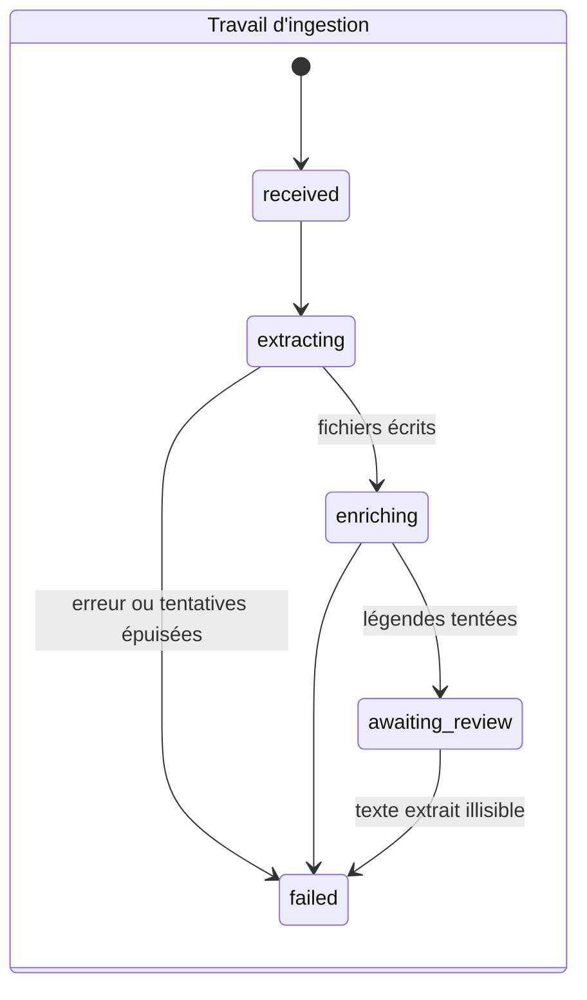
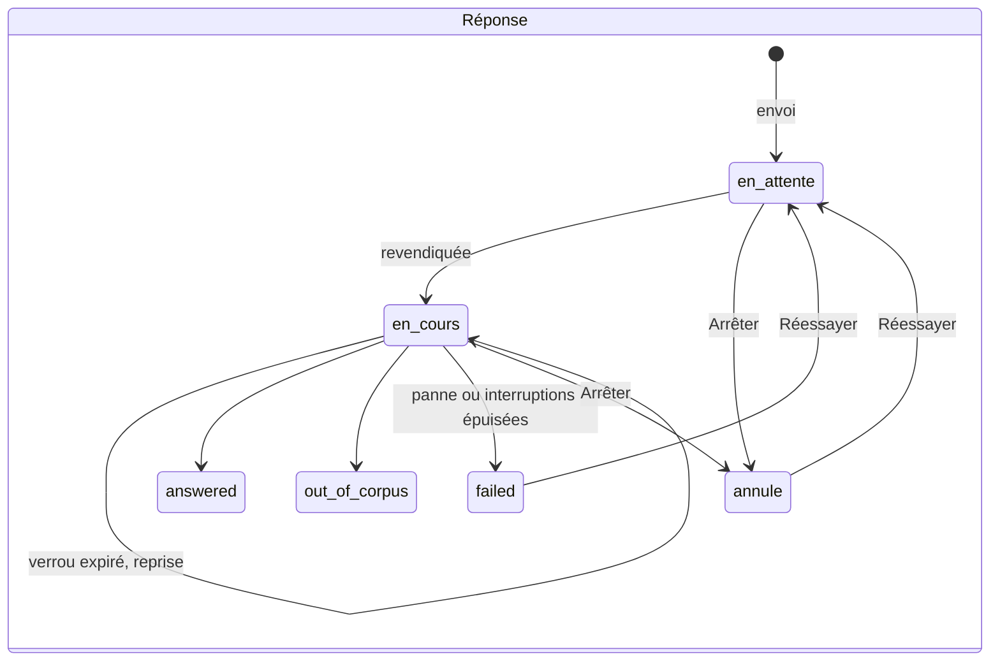
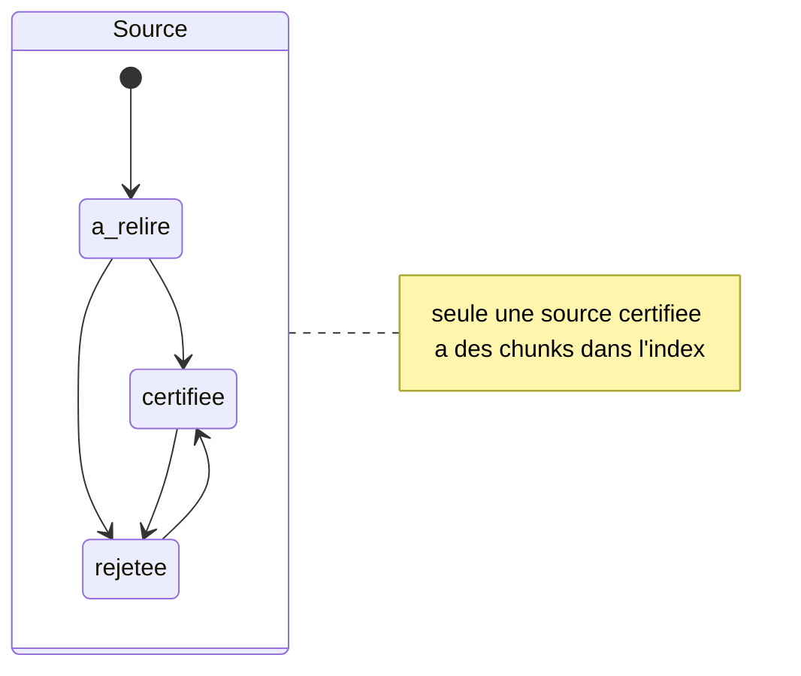
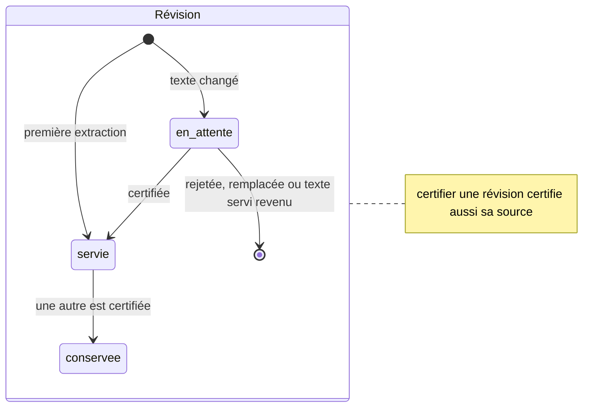
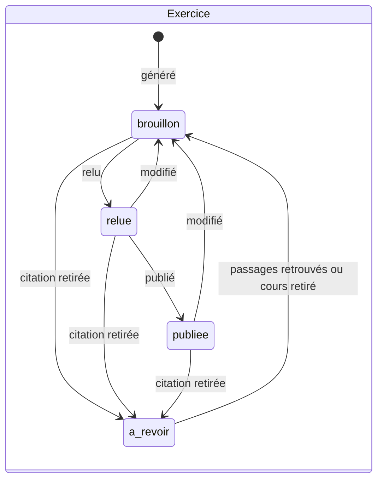
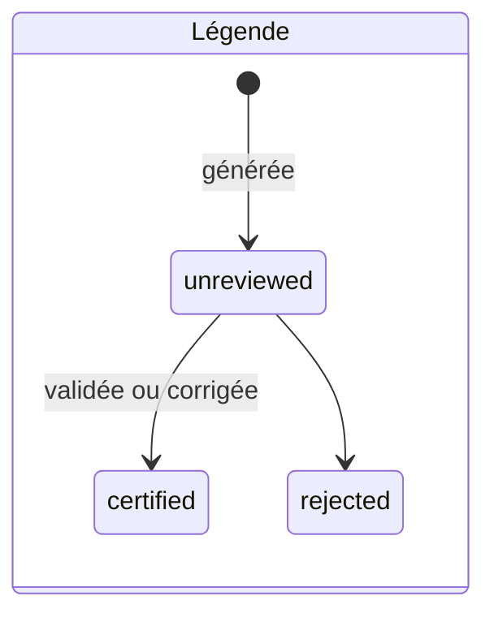
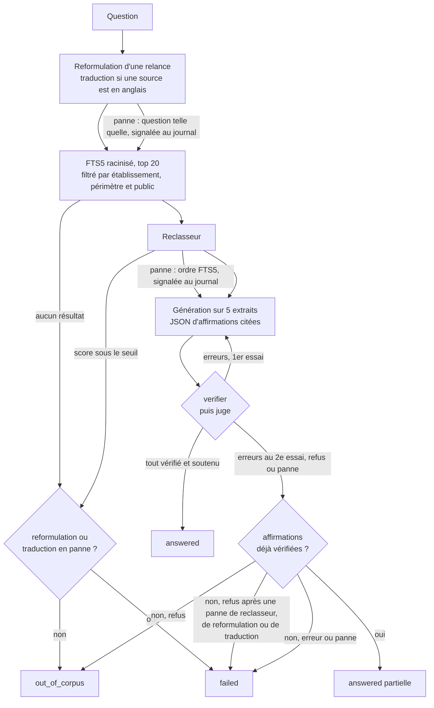

# Architecture

Ce document garde les règles que le code ne dit pas de lui-même. Les routes, le schéma, les
modèles et leurs réglages se lisent dans `src/app/routes/`, `migrations/` et
`src/app/config.ts`.

## Règles du produit

1. Une affirmation cite un passage retrouvé mot pour mot dans une source certifiée, que son
   lecteur peut lire et que Thot peut citer. Le passage est d'un seul tenant, sans points de
   suspension, et commence et finit sur un mot entier. `verifier()` dans `src/core/reponse.ts` le
   contrôle et garde le texte du document à la place de la copie du modèle. Un juge (`juger()`,
   même fichier) contrôle ensuite que ce passage, lu sous le titre de son extrait, prouve toute la
   phrase. Un juge injoignable ou plus lent que 4 s laisse passer
   l'affirmation et le note au journal. La réponse affiche alors « Vérification partielle » au
   lieu de « Réponse vérifiée ». Le dépassement du délai annule la requête du juge.
   Avant publication et à chaque relecture d'un échange, les preuves sont contrôlées à nouveau,
   dans la révision que cite la réponse. Si une preuve ou son titre a changé, ou si le lecteur
   n'y a plus accès, la réponse est signalée comme indisponible et peut être recalculée. Une
   nouvelle révision ne rend pas indisponible une réponse qui cite l'ancienne.
2. Une légende d'image générée et non relue sert à la recherche. Elle ne sert pas de preuve et
   ne s'affiche pas à l'élève. Chaque chunk porte donc deux textes : `rappel` pour la recherche,
   `preuve` pour la citation.
3. Une panne ne ressemble pas à une limite du cours. Une question aboutit à `answered`,
   `out_of_corpus` (rien d'assez proche dans le cours, ou refus du modèle) ou `failed` (panne de
   fournisseur, sortie vide, citations introuvables).
4. Un contenu pédagogique généré (fiche, quiz, page de wiki) reste invisible aux élèves tant
   qu'un enseignant ne l'a pas certifié. Les questions suggérées font exception : le worker ne
   garde que celles auxquelles la chaîne de réponse répond avec des citations vérifiées, et pas
   celles qui renvoient à une image ou à un extrait que l'élève ne voit pas. Après un refus, le
   reclasseur ne laisse passer que les questions proches de la question refusée, au seuil de la
   recherche. Aucune n'est proposée si rien n'est proche ou si le reclasseur est en panne.
5. Le corpus reste lisible sans l'application. Chaque source vit dans
   `data/content/{source}/` : original, images, `document.txt` et `blocs.jsonl` de sa révision 1,
   puis `revisions/{n}/` pour chaque révision suivante, avec les images qu'elle a apportées. La
   base dit quelle révision sert.
   L'index de recherche se reconstruit depuis les révisions servies par `thot rebuild`.
6. Le `document.txt` d'une révision est le système de coordonnées de ses citations, et son texte
   ne change plus. Une extraction dont le texte diffère de la révision servie devient une
   révision en attente, vérifiée bloc par bloc. Elle ne sert qu'une fois certifiée par un
   enseignant, ses images comprises, et l'index ne contient que la révision servie. Une
   extraction qui redonne le texte servi écarte la révision en attente. Une ancienne révision se
   lit avec les mêmes droits que la source : retirer l'accès à la source la retire aussi.
   Les offsets comptent des points de code, les chaînes JavaScript des unités UTF-16. Tout
   découpage passe par `src/core/texte.ts`.
7. Le choix d'un modèle est un réglage d'environnement. Il ne traverse pas le domaine.
8. Le corpus est théorique. Une source porte des notions, des exemples commentés et des procédures
   générales. Un exercice reste hors du corpus, quiz corrigés et étapes guidées compris, sinon Thot
   cite sa consigne comme un fait ([ADR 0009](decisions/0009-enonces-hors-du-corpus.md)).
   L'enseignant le retire avant le dépôt.

## Forme du système

Un monolithe Node.js lance deux processus depuis le même code. Le serveur Hono rend les pages et
calcule les réponses aux élèves. Le worker extrait les documents et génère légendes et questions
suggérées. Ils partagent `state.sqlite3`. Chaque file de travaux est une table SQLite avec un
verrou expirable : un processus tué reprend son travail au redémarrage.

Une question envoyée est un travail durable, porté par sa ligne de `messages`. La boucle de
réponses du serveur (`src/app/reponses.ts`) la calcule hors de toute connexion, avec un nombre
borné de réponses à la fois. Une longue extraction tourne dans le worker et ne retarde pas le chat.
Chaque revendication donne à la tentative un nouveau `generation_id`, et seule la tentative qui le
détient encore publie : une tentative expirée, arrêtée ou purgée n'écrit rien. Pendant le calcul,
la tentative renouvelle son verrou. Un renouvellement refusé interrompt son appel de modèle par
son `AbortSignal`. Avant de publier, la boucle revérifie les preuves avec les droits actuels de
l'élève. Une réponse interrompue plusieurs fois échoue avec la cause `INTERRUPTED`.

Un travail d'ingestion suit la même règle (`traiter()` dans `src/app/ingestion.ts`). Chaque
revendication incrémente `tentatives`, et ce numéro désigne la tentative. Le worker prolonge le
verrou sur une minuterie et avant chaque écriture : une extraction ou des légendes plus longues
que le verrou ne sont pas reprises par un autre processus. Une tentative dont le travail a été
repris, terminé ou supprimé n'écrit plus rien, ni fichier, ni ligne, ni échec. L'appel de légende
en cours va à son terme, `legender()` ne prend pas de signal, et son résultat est écarté.

`enregistrer()` range une extraction dans une seule transaction, fichiers compris, et y relit la
révision servie. Le worker et `thot reextraire` attendent l'extraction avant d'enregistrer : un
enseignant qui certifie la révision en attente pendant ce temps ne voit pas son dossier réécrit.

`src/core/` porte l'ingestion, la recherche et la réponse. Il n'importe rien de `src/app/`
(`pnpm frontiere`) et reçoit le périmètre des sources consultables en paramètre. Il ne reçoit
ni session ni requête HTTP.

Chaque fichier de `src/app/routes/` sert une partie de l'application, et `routes.ts` les monte
derrière la session et la protection CSRF. Une route lit la requête, appelle les modules de
`src/app/` et rend une vue de `vues/`. Les règles de la conversation vivent dans
`conversations.ts`, hors des routes. Aucune route n'écrit de règle d'accès, de statut ou de
compte dans son SQL. Elle lit par `LISIBLE` ou `CITABLE` de `src/core/recherche.ts`, ou appelle
le module qui porte la règle. `pnpm frontiere` le vérifie.

Le dépôt accepte PDF, Word (`.docx`), PowerPoint (`.pptx`), HTML, PNG, JPEG et Markdown. Le type
vient du contenu, sauf le Markdown qui n'a pas de signature : il demande l'extension `.md` ou
`.markdown`, des octets UTF-8 valides et aucun NUL. Son texte de preuve est celui que le lecteur
voit une fois la page rendue : les titres ATX (`#`) ouvrent les sections, les marques de lien et
d'emphase disparaissent, même autour d'un code en ligne, et les blocs de code et `mermaid` restent
mot pour mot. Le code en ligne garde son texte, et sa plage est notée hors du texte pour que le
lecteur l'affiche en code. Le langage nommé par la clôture d'un bloc est noté hors du texte : le
lecteur dessine un bloc `mermaid` en figure, avec le moteur des réponses, sans le front matter ni
les directives de l'auteur. Un bloc `animated` de carnet qui commence par `sequenceDiagram` se
dessine de même, dans son état final, et ses lignes `%% note:` passent en liste numérotée sous le
dessin. La légende reprend l'`accTitle` et l'`accDescr` du code, et le code se replie sous la
légende. Un dessin qui échoue laisse le code déplié. Le lecteur colore le code des autres langages que
Shiki connaît, sans changer le texte du bloc. Le front matter fournit le titre et l'ordre de
lecture (`order`), ses autres clés sont ignorées. Les images liées ne sont pas jointes, un avertissement les nomme.

Le lecteur garde les lignes d'un bloc : une liste extraite garde une entrée par ligne. Un bloc
dont toutes les lignes ont le même nombre de cellules séparées par « | » s'affiche en tableau,
sa première ligne en en-tête. Le texte du bloc et ses offsets ne changent pas. La feuille d'un
passage cité rend les blocs qui le portent comme le lecteur, si bien qu'une ligne de tableau citée
reste dans son tableau.

Une page HTML se lit comme le navigateur l'affiche, et seul son `<main>` compte quand elle en a
un. Scripts, styles, menus `<nav>`, boutons, listes de choix, zones de saisie et figures SVG
n'entrent pas dans le texte, et un avertissement compte les figures. Le premier `<h1>` donne le
titre, sinon le titre de l'onglet. Les titres ouvrent les sections. Une liste garde une ligne par
entrée, un tableau une ligne par rangée avec ses cellules séparées par « | ». Un `<pre>` reste mot
pour mot, avec le langage de sa classe `language-…`, et un `<code>` en ligne garde sa plage comme
en Markdown. Une image intégrée en `data:` entre dans sa section si elle est en PNG, JPEG ou GIF,
sous la borne de pixels des documents Word. Une image liée n'est pas jointe, et un avertissement
nomme celles d'un chemin relatif. Le profil arts appliqués lit toute page HTML comme un export
Pearltrees : un titre, des paragraphes, des intertitres en gras et la première image seule.

Un zip est un document Word quand `[Content_Types].xml` déclare `word/document.xml` comme document
principal, une présentation quand il déclare ainsi `ppt/presentation.xml`. Le dépôt refuse avec
sa raison un conteneur OLE (document chiffré, ancien `.doc` ou `.ppt`), un paquet à macros
(`vbaProject.bin` ou type `macroEnabled`) et tout autre zip. L'extraction ne lit aucun fichier ni
aucune adresse extérieurs au paquet. Ses bornes sont décrites dans
[l'exploitation](exploitation.md#extraction-word-et-powerpoint).

Mammoth lit un document Word. Son HTML devient des passages et n'atteint aucune page. Les titres
ouvrent les sections, une liste garde une ligne par élément, un tableau une ligne par rangée avec
ses cellules séparées par « | », ce qui garde chaque cellule citable. Les notes de bas de page se
lisent à la fin, sous « Notes ». Un lien garde son texte, sans son adresse. Une citation nomme sa
section et cite son paragraphe, sans numéro de page : la pagination d'un document Word dépend de
l'affichage. Le texte inséré en modification suivie se lit comme accepté, le texte supprimé est
écarté, et un avertissement signale ces modifications. Les commentaires n'entrent pas dans le
texte. Équations, zones de texte, objets intégrés, graphiques et SmartArt donnent un
avertissement.

Une présentation se lit dans l'ordre de sa liste de diapositives (`p:sldIdLst`), pas dans celui
des fichiers. Chaque diapositive ouvre la section « Diapositive n : titre », et le champ `page` de
ses blocs porte son numéro. Le titre se lit en tête. Quand toutes les formes d'un niveau ont une
position, elles se lisent par lignes, de haut en bas puis de gauche à droite. Sinon elles gardent
l'ordre du fichier, qui est celui de superposition. Les groupes se lisent à leur place. Pied de page, date et numéro venus du masque sont écartés. Graphiques, SmartArt,
équations, objets, sons, vidéos et animations donnent un avertissement qui nomme leurs
diapositives. Une diapositive masquée reste hors du texte et un avertissement la nomme. Sur la
page de la source, « Les inclure » relance l'extraction : le texte changé devient une version à
relire, comme toute réextraction.

Le worker lit les notes de l'orateur à l'extraction et les écrit à part, dans le `notes.json` du
dossier de la révision. Ni `document.txt`, ni l'index, ni les réponses, ni les pages élèves ne
les contiennent. La page de la source les montre à ceux qui la modifient, et l'original d'une
présentation ne se télécharge que par eux. Un élève ne télécharge aucun original.

Une image d'un document Word ou d'une présentation garde la section où elle apparaît
(`images.section`), et sa légende accompagne le premier passage de cette section. Une image
répétée sur plusieurs diapositives entre une fois, avec la première. Seuls PNG, JPEG et GIF sont
importés, sous une borne de pixels. Les autres formats (EMF, WMF, SVG…) donnent un avertissement.

La table `images` ne porte que les images servies, et chaque ligne garde la révision qui l'a
apportée (`images.revision`). Une extraction qui redonne le texte servi range ses images en
place. Une extraction qui devient une révision en attente écrit dans le dossier de cette
révision ses images nouvelles et leur liste (`images.jsonl`), avec la légende proposée pour
chacune. Certifier la révision sert cette liste, et les images que la révision n'a plus sortent
avec leurs fichiers. La rejeter efface son dossier. Une image se reconnaît à ses octets : tant
qu'une extraction la rend, elle garde son identifiant, sa légende et sa relecture, même à une
autre place. Une image répétée dans un document entre donc une fois. `thot reextraire` ne lit
pas les images : certifier sa révision laisse celles de la source telles quelles.

Le dépôt web prend plusieurs fichiers. Chacun passe par `deposer()` seul : une source, un travail
d'ingestion, aucune dépendance entre fichiers. Avec JavaScript, le navigateur envoie un fichier
par requête, trois à la fois. Sans JavaScript, le serveur dépose les fichiers d'une requête l'un
après l'autre et liste le sort de chacun. Les champs communs (matière, cours, lecteurs) valent
pour tout le lot. Le titre vient du fichier (front matter pour le Markdown, sinon le nom sans
extension), le nom saisi au formulaire ne vaut que pour un fichier seul.

Le formulaire avance par étapes : fichiers, cours, lecteurs, puis informations facultatives. Il
range le lot dans un seul cours, et la source prend la matière de ce cours. D'autres cours
s'ajoutent sur la page de la ressource. Un administrateur crée le cours, et au besoin sa matière,
depuis l'étape du cours. Chaque requête du lot porte les mêmes noms : la première crée la matière
et le cours, les suivantes les retrouvent par leur nom.

- Un lot (`sources.lot_id`) groupe les fichiers d'un même formulaire. La bibliothèque le filtre
  par `/prof?lot=`. Le serveur refuse le fichier qui ferait dépasser `MAX_LOT` sources au lot, et
  chaque fichier de plus de `MAX_OCTETS`.
- Une clé de dépôt (`sources.cle_depot`) rend un renvoi inoffensif. Le navigateur en tire une par
  fichier. Le formulaire sans JavaScript la déduit du lot, de la position et de la somme de
  contrôle du fichier : un autre fichier envoyé sous le même lot, depuis un formulaire que le
  navigateur a gardé, est un autre dépôt. La même clé du même
  compte rend la source déjà créée, sans second travail. Un index unique tranche deux requêtes
  simultanées.
- Un fichier dont la somme de contrôle est celle d'une source que le compte peut lire est un
  doublon : rien n'est écrit et la réponse renvoie cette source. La recherche passe par
  `FILTRE_ACCES`, donc un fichier identique à une source privée d'un autre compte se dépose
  normalement et ne révèle pas qu'elle existe. L'import en ligne de commande compare, lui, toute
  l'instance.

## Instances

Une installation possède son identité persistante, ses comptes et son répertoire de données.
Deux installations partagent le code, jamais un volume applicatif. Renommer une installation ne
change ni son identité ni ses sources. L'ancien identifiant d'établissement est repris des sources
existantes, ou de l'environnement pour une base vide. Une base qui contient plusieurs
établissements exige une séparation explicite avant son initialisation.

Le nom et le mode d'usage sont enregistrés en base. Un administrateur renomme l'instance depuis
l'administration, le mode y reste en lecture seule. Chemins, origine, nombre de proxys, clés,
fournisseurs autorisés et localisations déclarées restent des réglages d'opérateur. La localisation affichée ne prouve
pas le lieu d'exécution du fournisseur. Désactiver un fournisseur interdit aussi son emploi en
repli, même si sa clé est présente.

Le mode personnel conserve les contrôles de relecture et de publication du pilote. Son propriétaire
peut gérer les documents et les étudier avec le même compte, sans classe obligatoire. Le mode est
choisi avant la création des comptes.
L'autorité d'administration est accordée explicitement par l'opérateur, jamais à tous les enseignants.

## Matières, cours et profils

Une instance a un seul profil d'import, partagé par ses matières et ses ressources. Un
établissement qui a besoin des deux profils fait tourner deux instances. Un cours regroupe des ressources avec un public et un
objectif facultatifs. Un thème appartient à un cours. Les identifiants, jamais les libellés,
séparent les thèmes homonymes. Renommer garde les identifiants, donc les rattachements. Une
matière, un cours ou un thème ne se supprime que si ni une ressource, ni une question d'élève,
ni un objectif d'apprentissage ne l'utilise. Les anciennes matières et séquences gardent leurs métadonnées,
leurs sources et leurs citations. Une matière absente reste non classée.

Le thème est le seul regroupement des ressources. Le dépôt choisit un thème pour chaque cours
coché. Les formulaires n'ont pas de champ libre « séquence ». La séquence reste lisible dans les
métadonnées des anciennes sources, et l'import CLI la remplit avec le nom du dossier. Une
séquence envoyée au dépôt range la source dans le thème de même nom du cours, créé s'il manque.
L'import CLI range d'après le chemin importé, quelle que soit sa forme : son premier sous-dossier
donne le thème, et un fichier posé à sa racine va directement dans le cours. Un cours importé
d'un dossier à plat n'a donc aucun thème tant qu'on n'en crée pas. Le périmètre d'une question est
un thème, pas une séquence. Une adresse ou une page d'avant les thèmes qui nomme une séquence
mène au thème où sont rangées le plus de sources de cette séquence, dans un cours du compte
d'abord. Une question posée dans une séquence qu'aucun thème ne remplace est refusée.

Dans un thème, les ressources se lisent par séance, puis par ordre de lecture, puis par titre.
Une ressource sans ordre suit celles qui en ont. Le dépôt prend l'ordre d'un Markdown dans son
front matter, et l'enseignant le change sur la fiche de la ressource. Le lecteur d'un cours
général mène à la ressource précédente et à la suivante, et liste celles du thème à gauche du
texte quand l'écran a la place de trois colonnes. Une ressource sans thème se lit parmi celles
rangées directement dans son cours, le premier des cours du lecteur qui la rattachent.

L'en-tête de recherche de chaque passage (`rappel`) porte les noms des thèmes de la source, tous,
par ordre alphabétique. Une source sans thème garde sa séquence. Renommer un thème réindexe ses
sources. L'en-tête sert à la recherche et au reclasseur. Il n'entre ni dans `preuve` ni dans le
titre que voient le juge et l'élève.

Rattacher une source à plusieurs cours ne copie ni son original ni ses informations relues.
Son propriétaire, sa certification et ses lecteurs restent ceux de la source. Un rattachement
ouvre la source aux membres du cours, dans la limite de ses lecteurs. Un enseignant ne rattache
qu'à ses cours. Tout compte, administrateur compris, garde au moins un cours sur une source déjà
rattachée : sans cours, toute l'instance la lirait. Un dépôt sans cours coché se range dans le
premier cours de sa matière dont le déposant est membre. Sans un tel cours, il reste non classé.

Les profils fixes se lisent dans `src/core/profils.ts`. Le profil général garde un vocabulaire
neutre. Le profil arts conserve les rubriques ATC, la lecture des exports Pearltrees, les
propositions de métadonnées artistiques et le quiz d'identification. Il garde aussi les consignes
de réponse, de juge, de suggestion et de légende mesurées sur le pilote. La première matière fixe
le profil de l'instance. Une seule action le change pour toutes les matières, tant qu'aucune
ressource n'a un autre profil. Ensuite, l'administration et la CLI refusent une matière d'un
autre profil. La source capture le profil au dépôt, y compris sans matière. Une réextraction
conserve ce profil.

Un profil est un préréglage de code. Il fixe les traitements construits ou mesurés pour lui et
fournit les termes et les champs du dépôt par défaut. Les réglages de l'administration
n'enregistrent que ce qui s'en écarte : un terme vide, ou une matière dont les champs n'ont jamais
été enregistrés, reprend le profil. Changer de profil avant le premier dépôt change ces valeurs
par défaut sans réécrire les réglages enregistrés. Un autre traitement demande un nouveau profil
en code, avec sa propre évaluation.

Les termes de matière, de cours, de niveau et de regroupement appartiennent à l'instance, pas à
la matière : l'accueil de l'élève et la bibliothèque montrent plusieurs matières sur une page. Un
terme se règle au singulier et au pluriel, sans genre. L'interface ne l'accorde donc avec aucun
article ni adjectif. Le terme de regroupement nomme les thèmes partout, administration comprise.
Les termes de matière et de cours nomment les titres, les champs, les colonnes et le choix du
cours. Les phrases de l'interface disent encore « matière » et « cours ».

Les champs du dépôt appartiennent à chaque matière. Une matière coche des champs prédéfinis et
des champs personnalisés de l'instance, de type texte, date ou mots-clés. La valeur d'un champ
reste dans les métadonnées de la source, sous la clé du champ. Renommer le champ garde sa clé.
Ses valeurs suivent la validation des champs prédéfinis. Retirer un champ d'une matière le
masque des formulaires et de la lecture, sans effacer ses valeurs. Un champ personnalisé ne se
supprime que si aucune ressource ne porte de valeur pour lui. Une matière arts garde la date,
l'artiste et le mouvement, que lisent les propositions de Thot et le quiz.

Aucun réglage n'atteint un modèle : ni terme, ni nom ou valeur de champ. Les consignes viennent
du profil des sources retrouvées. Une consigne écrite pour un autre public modifie le profil et
rejoue l'évaluation.

Les lecteurs par défaut d'un dépôt s'appliquent aux dépôts suivants, par le web comme par la CLI.
Les ressources déposées gardent leurs lecteurs. Le mode personnel n'a pas ce réglage : un dépôt
n'y a qu'un lecteur.

Seuls les administrateurs modifient ces réglages. Chaque formulaire s'enregistre en entier ou
pas du tout. Les réglages de l'instance et la liste des champs de chaque matière portent une
version : un enregistrement parti d'une version périmée n'enregistre rien et rend la saisie avec
la version actuelle.

La langue décrit la source, pas sa matière ou son niveau. Une source anglaise (`en`, `en-GB`…)
s'indexe avec les racines anglaises, toute autre avec les racines françaises. Changer la langue
d'une source la réindexe. Quand le périmètre d'une question contient une source anglaise
citable, la recherche ajoute aux racines françaises de la question ses racines anglaises, et un
appel de modèle traduit la question. Les candidats FTS5 de la traduction rejoignent ceux de la
question avant le reclasseur, qui lit la question de l'élève. Une traduction en panne laisse la
question seule. Sans source anglaise dans le périmètre, la question garde ses seules racines
françaises et aucun appel de traduction n'a lieu. La réponse
reste en français et cite le passage anglais mot pour mot. Les autres langues restent signalées
comme non prises en charge. Les mesures sont dans `evaluation/README.md`, « Jeu langues ».

## Lecteurs et propriétaire

Une source appartient au compte qui l'a déposée. Ses lecteurs sont son propriétaire seul, les
enseignants, ou les enseignants et les élèves. Les administrateurs lisent et gèrent toutes les
sources, y compris celles sans propriétaire. Un élève ne lit que les sources certifiées. Thot cite
une source dans une réponse seulement si la case « Thot s'en sert pour répondre » est cochée : une
source peut se lire sans servir de preuve. La recherche de la bibliothèque montre toute source
certifiée lisible.

Les membres d'un cours sont ses enseignants et ses élèves. Une source partagée avec les enseignants
se lit par les enseignants membres de ses cours, une source publiée aux élèves par tous leurs
membres. Une source sans cours garde l'audience de toute l'instance. Le propriétaire et les
administrateurs lisent sans être membres.

`FILTRE_ACCES` dans `src/core/recherche.ts` porte cette règle, avec le statut certifié exigé de
l'élève. Les pages élève passent par `CITABLE`, qui exige aussi la certification quand un
enseignant les ouvre. La recherche, les pages de lecture,
les images, les filtres de cours et la relecture des réponses l'appliquent avec le compte qui lit.
Retirer un membre retire l'accès à la prochaine requête, y compris à la revalidation des preuves
d'une ancienne réponse. Un appel avec `lecteur: null`, comme la génération de suggestions par le
worker ou les évaluations en ligne de commande, voit les sources publiées aux élèves de tous les
cours.

Le propriétaire et les administrateurs modifient une source, la certifient et relisent ses
légendes. Les enseignants de ses cours le font aussi quand elle n'est pas privée. Les questions
suggérées et le fait de l'accueil suivent le lecteur. Un cours ne se nomme qu'à ses membres, et un
élève ne pose une question dans un cours que s'il en est membre. `/prof/questions` montre à un
enseignant les échanges de ses cours. Une comparaison va aux enseignants des cours de ses
matières. Un échange sans cours va aux enseignants qui partagent un
cours avec l'élève, ou à tous s'il n'en a aucun. Un enseignant ne voit et ne réinitialise que les
élèves qui partagent un de ses cours. Seuls les administrateurs gèrent les élèves sans cours. Un
enseignant crée les élèves de ses cours, chacun inscrit à au moins un, et les en retire. Il
n'inscrit pas un compte existant :
l'inscription lui donnerait la réinitialisation de son mot de passe, donc le compte. Un élève qui a
déjà un compte rejoint un cours en ouvrant lui-même un lien d'inscription. Le lien inscrit des
élèves seulement, aux cours dont son créateur est encore membre. Sa page nomme ces cours à
quiconque détient le lien. `/prof/eleves` ne donne donc son adresse qu'aux enseignants membres de
tous ses cours. L'enseignant d'une partie de ses cours voit que le lien existe et le révoque.
L'inscription refuse un identifiant déjà pris avec le message d'un identifiant invalide : la page
ne dit pas quels comptes existent. Après la connexion, l'adresse de retour n'accepte qu'un lien
d'inscription. Les administrateurs lisent tout. Une image se revalide à chaque affichage : un accès
retiré s'applique aussitôt.

Un élève choisit son mot de passe. Celui qu'un enseignant lui remet, à la création du compte ou
après une réinitialisation, est un code provisoire. La première connexion le consomme et impose
d'en choisir un autre : la feuille d'identifiants que garde l'enseignant n'ouvre plus le compte.
Avec un lien d'inscription, l'élève saisit le sien en créant son compte. Un élève ou un enseignant
change ensuite son mot de passe depuis son menu en donnant l'ancien, ce qui ferme ses sessions.

Le nom de déposant d'une source importée ou migrée désigne son propriétaire quand un seul
enseignant le porte. Sinon, la source reste sans propriétaire et le nom reste affiché.

## Rejeter et supprimer une source

Rejeter retire la source de l'index et des élèves. Ses fichiers, ses images et les réponses qui la
citent restent, et elle peut être certifiée de nouveau. Supprimer est définitif, pour un droit
d'auteur, une erreur ou une demande RGPD. Seuls son propriétaire et les administrateurs la
suppriment. Les enseignants de ses cours la modifient et la rejettent, mais ne suppriment pas un
original qu'ils n'ont pas déposé. Le web et `thot supprimer source` passent par
`supprimerSource()` dans `src/app/ingestion.ts`.

Une transaction retire la ligne de la source et tout ce qui en dérive : révisions, chunks et index
plein texte, images et légendes, rattachements, suggestions, travail d'ingestion et légendes en
cache. Le dossier `data/content/{source}/` part ensuite. Une réponse conservée perd les
affirmations qui citent la source. Sans affirmation, elle devient indisponible avec « Une source
citée a été supprimée. », et l'élève peut la relancer. Une réponse à plusieurs sources garde les
autres affirmations, chacune avec sa citation, en un paragraphe, et dit qu'une partie a été
retirée. Ses blocs disparaissent : leurs titres viennent du modèle sans preuve et ont pu nommer la
source. Le journal perd les candidats de la source et les sorties du modèle, qui recopient les
extraits. Questions et titres de conversation restent : ils viennent de l'élève.

Une réponse en cours qui a retrouvé la source ne publie rien d'elle. La revérification avant
publication la rend indisponible, et la boucle retire du journal les sources supprimées pendant le
calcul. Une suggestion en cours échoue sur la clé étrangère. La suppression est refusée tant que
le worker extrait la source sous un verrou valide : il réécrirait ses fichiers et le cache. Le
worker prolonge ce verrou jusqu'à la fin du travail.

Le texte de la source quitte aussi le fichier de la base : `secure_delete` sur chaque connexion,
l'option `secure-delete` de l'index plein texte (migration 0017), puis un point de contrôle qui
vide le WAL. Une légende en cache se retrouve par l'empreinte de sa requête, calculée sur les
octets de l'image et le modèle de légende actuel. Une légende mise en cache sous un autre modèle,
ou pour une image qu'une réextraction a remplacée, reste dans `cache_modeles`. Les sauvegardes et
les rapports d'évaluation de `data/evaluation/` ne sont pas touchés
([exploitation](exploitation.md#données-personnelles)).

## Activités sourcées

Une activité est un exercice ou une explication d'étude
([ADR 0010](decisions/0010-series-de-questions.md)). Un objectif d'apprentissage appartient à un
cours. Sa référence (référentiel ou programme, compétence et version) reste un texte libre que Thot
n'interprète pas : rien ne déduit qu'un document couvre un objectif. La préparation reprend
l'objectif du cours de même intitulé, sans compter la casse ni les accents, au lieu d'en créer un
second.

Un exercice est une série de questions de quatre types : choix unique, choix multiple, réponse à
taper et réponse rédigée (`src/core/activite.ts`). Une réponse rédigée peut porter un langage :
l'élève répond en code, que rien n'exécute. Toute question peut montrer une image et nommer une
source du cours où chercher. Une version, une relecture et une publication valent pour toute la
série.

Thot rédige une série depuis un objectif et une à quatre sources certifiées du cours, publiées à ses
élèves et utilisées par Thot pour répondre. Un appel du générateur rédige chaque question, et les
appels partent ensemble. Chaque champ que Thot rédige cite des passages que `verifier()` retrouve
mot pour mot dans l'extrait désigné, avec la révision et les offsets de leur source. Un champ dont
une citation ne se retrouve pas, ou ne se retrouve que dans une légende d'image, est rejeté et
compté, comme le prévoit l'ADR 0002. Une option fausse n'affirme rien et ne cite donc rien, mais une
bonne option mal ancrée fait tomber sa question. La réponse acceptée d'une réponse à taper doit
figurer dans un passage cité. Une question rejetée laisse les autres dans la série. Sans aucune
question ancrée, rien n'est enregistré, pas même un nouvel objectif.

L'enseignant écrit aussi ses propres champs, sans citation, et la page dit alors « Rédigé par
l'enseignant ». Il ajoute, duplique, déplace et supprime des questions. Chaque passage qu'il colle
est recherché mot pour mot dans la version servie de sa source, et le formulaire ne reprend rien
d'autre d'une citation (`src/app/edition.ts`). Un quiz de carnet-quiz s'importe comme une série de
champs rédigés par l'enseignant, sans ses pièges, son chrono ni ses images. Thot donne ses propres
identifiants aux questions et aux options, parce que ceux du fichier entreraient tels quels dans
les adresses et les formulaires. Un quiz plus long qu'une série (`MAX_QUESTIONS`) est refusé, avec
cette raison.

Une citation retrouvée ne prouve que son passage : un premier essai réel gardait un retour qui en
disait plus que ses citations. Le juge de soutien des réponses lit donc chaque champ cité contre
ses passages mis bout à bout, un appel par champ, avec la consigne du profil général et
`SEUIL_SOUTIEN`. Il ne rejette rien. Un champ qu'il ne soutient pas est « À vérifier » dans la page
de l'enseignant, et un juge en panne ou trop lent laisse « Juge indisponible ». L'avis est enregistré
dans le champ, avec la version : afficher la page ne rappelle pas le juge. Une modification fait
juger les champs dont le texte ou les passages changent, et ceux restés sans avis. Publier ne
demande pas l'avis du juge : la relecture de l'enseignant reste la barrière.

Une explication part du même choix de cours, d'objectif et de sources. Thot pose l'objectif comme
une question à `demander()`, dans les sources choisies seulement (`Perimetre.sources`). L'explication
garde la réponse vérifiée : affirmations, citations avec la révision de leur source, blocs, et l'avis
du juge que `demander()` applique déjà à chaque phrase. Hors corpus ou en panne, rien n'est
enregistré. L'élève la lit comme une réponse, avec la feuille du passage cité, sans tentative ni
corrigé. Elle ne se modifie pas : l'enseignant en prépare une autre.

Une activité est brouillon, relue, publiée ou à revoir. Une relecture vaut pour une version de
l'activité. Chaque modification crée une version en brouillon, et la relecture précédente ne vaut
plus pour elle. Le titre et la date à rendre, qui ne bloque rien, ne créent pas de version. Une
relecture, une publication ou une modification partie d'une version périmée est refusée. Publier
demande une version relue et des preuves qui tiennent encore. Une série dont une question a une
erreur, une consigne vide par exemple, ne se relit pas et ne se publie pas. L'historique garde qui a relu, publié
ou modifié chaque version, et quand. Une activité archivée n'est plus servie, et ses tentatives
restent lisibles. Seul un brouillon jamais publié et sans tentative se supprime.

Une activité appartient à un ou plusieurs cours. Le cours où elle est née porte son objectif et ne
se retire pas. Un cours ne s'ajoute que si les sources que l'activité cite ou montre y sont
rattachées. L'élève reçoit l'activité dans un de ses cours où ses preuves tiennent, et sa liste la
range sous ce cours.

La liste des ressources de l'élève montre ses cours, chacun avec son nombre de chapitres, ce qu'il
en a lu et ses activités à faire, puis les ressources hors cours. Thot n'affiche pas de temps de
lecture : comprendre une ressource prend plus longtemps que la lire, et une durée fausse
découragerait l'élève qui la dépasse. Un cours n'y figure que s'il a des
ressources dans le périmètre choisi. Un cours choisi s'ouvre sur son sommaire : ses ressources
numérotées dans l'ordre de lecture, celles sans thème en tête, puis un groupe par thème. La
numérotation part de 0 quand la première ressource a l'ordre 0, l'introduction d'un cours importé
d'un carnet. Chaque activité publiée suit la dernière ressource du sommaire qu'elle cite, montre
ou désigne pour chercher, avec son avancement : à faire, en cours, remise, retour reçu. Celle qui
ne renvoie à aucune ressource du cours ferme le sommaire. L'accueil par chapitres, qui ne titre
pas les cours, liste les activités après ses chapitres.

Une ressource est lue quand l'élève a vu la fin de son texte dans le lecteur. Seul l'élève voit
ses lectures : aucune page d'enseignant ou d'administrateur ne dit qui a lu quoi. Elles viennent
de lui, et suivent la purge de `THOT_RETENTION_JOURS` comme ses échanges. Le lecteur d'une ressource propose sous « S'entraîner » les
activités publiées qui la citent, montrent une de ses images ou y renvoient.

La bibliothèque, les ressources de l'élève et la recherche reprennent le dernier cours choisi dans
le même navigateur. « Toutes les ressources » efface ce choix, la déconnexion aussi.

Un élève pratique les exercices publiés des cours dont il est membre. L'enseignant règle quand le
corrigé sort : après la remise de la série, ou après chaque question. Avant, la page ne contient
que les consignes, les options et les images. La réponse attendue, les critères, le retour, les
bonnes options, les réponses acceptées et les passages cités d'une question ne sortent du serveur
qu'avec une tentative de ce compte où cette question est finie, la série une fois remise quand le
corrigé la suit. Les options se mélangent pour chaque élève, et le navigateur envoie la lettre affichée, pas
l'identifiant de l'option : l'ordre des identifiants trahirait la bonne réponse. Le mélange dépend
du secret de l'instance, donc un élève qui connaît le code, son compte et la question ne retrouve
pas l'ordre d'origine. Quand le corrigé
suit chaque question, une question fermée laisse deux essais, l'indice apparaît après une première
erreur et le deuxième essai vaut 0,5 point. Quand il suit la série, l'élève enregistre ses
réponses, revient, puis remet, avec un essai par question.

Chaque formulaire de réponse porte la version que l'élève lit, et une tentative garde la version à
laquelle elle répond. Si l'enseignant publie une autre version entre-temps, l'envoi reçoit 409 et
rien n'est enregistré, parce que les lettres reçues désignent les options de l'ancienne version. La
page de la nouvelle version s'affiche alors avec ce que l'élève avait écrit dans les réponses à
taper et rédigées, et ses choix sont à refaire. Un texte trop long laisse en place la réponse déjà
enregistrée et empêche la remise : la page le dit et garde la saisie. Sa longueur se mesure avec
des fins de ligne d'un caractère, comme le navigateur la compte.

Après une nouvelle version, l'élève retrouve sa dernière tentative remise, avec la version à
laquelle il répondait, ses points, la note et le commentaire de l'enseignant. Le corrigé ne sort
que pour les questions que cette tentative a finies. Une question ajoutée depuis reste sans corrigé
et sans champ, et ne compte pas dans ses points. Une question que Thot rédige de nouveau prend un
nouvel identifiant : elle compte donc comme ajoutée, pour l'élève comme dans la grille de
l'enseignant. La note et le commentaire d'une question retirée restent dans le bilan. L'élève ne
répond à la nouvelle version que si l'enseignant marque sa tentative à reprendre. Un brouillon
qu'il n'avait pas remis ne revient pas, et il repart d'une série vierge.

Thot corrige les questions fermées d'après les réponses de l'enseignant. Une réponse à taper se
compare mot à mot avec chaque réponse acceptée, sans casse, sans accents ni ponctuation
(`correspond()` dans `src/core/questions.ts`). Un mot de liaison, « la » ou « de » par exemple,
s'efface devant un autre mot. Le dernier mot d'une réponse reste toujours, parce qu'il peut être la
réponse : « balise » ne vaut pas « balise a ». Le signe moins collé devant un chiffre fait partie du
nombre, donc « 1 » ne vaut pas « -1 ». Les deux réponses doivent ensuite avoir autant de mots, et
chaque mot se compare à celui de même rang. Un mot de 5 lettres tolère une faute de frappe, un mot
de 10 lettres en tolère deux, et un mot plus court ou qui contient un chiffre se compare exactement.
« Wiliam Morris » vaut donc « William Morris », alors que « hépatite C » ne vaut pas « Hépatite A »
ni « H2SO3 » « H2SO4 ». Une réponse rédigée n'a pas de note automatique : l'élève coche les
critères qu'il pense remplir. Un modèle ne note rien.

Un enseignant lit les tentatives des élèves de ses propres cours parmi ceux de l'activité, toutes
versions confondues. L'auteur d'une activité privée lit les siennes. Être administrateur ne suffit
pas. L'essai d'un enseignant sur la série publiée n'est pas une remise : il ne se compte pas et un
collègue ne le note pas. La page « Réponses » montre une ligne par élève suivi, sa dernière tentative et une case par
question. L'enseignant note une réponse 0, 0,5 ou 1, ce qui remplace la note automatique, la
commente, et peut marquer la tentative à reprendre : l'élève en commence alors une autre. Sous la
grille, la page liste les réponses fermées que Thot a refusées, pour que l'enseignant puisse leur
donner des points. Elle liste aussi les réponses à taper que Thot a acceptées alors qu'elles
diffèrent de chaque réponse acceptée autrement que par la casse ou les espaces : un accent, un mot
de liaison ou une faute de frappe. L'enseignant refuse celles qui sont fausses en les notant 0. Ces
points comptent ce qui a été pratiqué : ils ne mesurent pas un niveau.

Une citation tient tant qu'elle vise la révision servie d'une source certifiée, rattachée au cours,
publiée à ses élèves et utilisée par Thot. Une source qu'une question montre sans la citer, par son
image ou comme source où chercher, doit rester citable de la même façon. Chaque changement d'une
source passe par `src/app/ingestion.ts`, par le web comme par la CLI : la même transaction écrit,
réindexe et signale à revoir les activités dont une preuve ne tient plus dans un de leurs cours.
La page de l'élève revérifie les preuves à chaque affichage. Une activité à revoir n'est plus
servie. L'enseignant fait rechercher ses passages dans la révision servie, ou retire le cours
fautif, et l'activité redevient un brouillon à relire si son contenu n'a pas d'erreur. Une tentative
garde la version de l'exercice à laquelle elle répondait.

Supprimer une source retire de chaque exercice ses passages, le texte des champs qui les citaient,
rédigés d'après elle, l'image prise dans la source et le lien pour y chercher. Une explication perd
les phrases qui la citaient, et ses blocs, dont les titres ont pu nommer la source. Ce contenu
réduit est une nouvelle version, à revoir : une relecture partie de la version précédente ne vaut
pas pour lui. L'enseignant supprime ou corrige ensuite chaque question vidée, une à la fois, parce
qu'une modification ne contrôle que les questions qu'elle change. La série reste à revoir tant
qu'une question est vide, même si l'enseignant retire un cours. Une explication qui a perdu toutes
ses phrases ne se relit plus. Les réponses des élèves restent : elles viennent d'eux, et suivent la purge de
`THOT_RETENTION_JOURS`, avec les notes et commentaires de l'enseignant.

Une image déposée avec une activité est rangée dans `activites/` du dossier de données. Son format
vient de ses octets : PNG, JPEG, WebP ou GIF, 5 Mo au plus. Elle n'est servie qu'à un enseignant
d'un cours de l'activité, ou à un élève à qui la version publiée la montre.

En mode personnel, une activité reste privée à son auteur, cours compris. Il la relit et la publie
pour lui-même, et la page dit que personne d'autre ne l'a relue.

## Conversations

Une conversation appartient au compte qui l'a ouverte. Pour tout autre compte, son adresse, ses
actions et ses échanges répondent 404, comme un identifiant inconnu : afficher, renommer,
archiver, désarchiver, changer de périmètre, envoyer, relancer, arrêter, donner un avis, suivre le
flux et ouvrir une citation. Son titre reste privé : `/prof/questions` liste les échanges un par
un, selon les cours de l'enseignant, sans passer par la conversation. L'enseignant y ouvre un
échange en lecture seule : la question, la réponse et ses passages, relus avec ses propres droits.
Cette page ne nomme pas la conversation, ne montre pas ses autres échanges et n'y mène pas. Elle
suit la règle d'accès de la liste, et un échange absent de la liste répond 404. Ces règles vivent
dans `src/app/conversations.ts`, et les routes traduisent ses refus en 404, 409 ou 429.

La liste se filtre par le titre ou le texte d'une question (`?q=`, LIKE sans joker). Les
conversations archivées ne sortent que de leur propre vue. Le navigateur garde, par compte et par
conversation et le temps de l'onglet, le brouillon, la position de lecture et le passage ouvert.
Sans `sessionStorage`, la page marche sans cette mémoire.

Chaque échange garde le périmètre qu'il a utilisé. Changer le périmètre d'une conversation vaut
pour les questions suivantes, et chaque envoi revérifie que l'élève peut encore interroger ce
périmètre. La recherche d'une question ne reprend que la question précédente de la même
conversation, si elle a été posée dans le même périmètre. Rien ne passe d'une conversation à une
autre, ni d'un périmètre restreint à un périmètre plus large.

Un périmètre peut aussi comparer deux à quatre matières entières, cochées dans le formulaire
« Changer ». Une seule case cochée vaut le périmètre de cette matière. Chaque matière comparée doit
offrir au lecteur une source lisible, sinon le périmètre est refusé. La conversation et chacun de
ses échanges gardent la liste des matières comparées.

Une conversation porte une réponse à la fois, ce qui garde l'ordre de ses tours. L'envoi et la
relance le vérifient dans la transaction qui met la question en file : deux onglets n'en mettent
pas deux. Un envoi pendant une réponse, ou dans une conversation archivée, reçoit 409 et l'élève
garde sa saisie. Un compte met en file `MAX_QUESTIONS_HEURE` questions par heure au plus. La
même transaction compte ses échanges de l'heure écoulée : au-delà, l'envoi et la relance reçoivent
429 avec l'attente avant la prochaine question, et l'élève garde aussi sa saisie. Une relance ne
crée pas d'échange, donc elle ne compte pas dans cette limite.

Un envoi rejoué avec la même clé et le même texte retrouve son premier échange.
Sous la même clé, un autre texte est une autre question et ouvre un autre échange : une page que
le navigateur ressort de son historique garde la clé de son premier affichage. Une conversation
vidée par la purge disparaît avec son titre, qui reprend souvent une question. Une réponse en
cours perd alors sa ligne : sa tentative s'interrompt et ne recrée rien.

La réponse continue quand l'élève ferme la page. Le flux SSE lit l'étape enregistrée, puis la
réponse : le fermer n'arrête ni ne relance le calcul, et une reconnexion repart de l'état
enregistré. « Arrêter » marque la réponse arrêtée et interrompt son appel de modèle. La question
reste et se relance avec « Réessayer ». Une relance efface l'avis, qui portait sur la réponse
remplacée. La liste relit le statut d'une réponse en file ou en cours
sans déplacer le focus. Elle marque « Nouvelle réponse » une réponse terminée que l'élève n'a pas
vue, jusqu'à l'ouverture de sa conversation.

## États

## Réponse à une question

Le seuil d'abstention est une probabilité du reclasseur et ne s'applique pas aux rangs FTS5. En
panne du reclasseur, le générateur et le juge décident seuls. Leur refus donne `failed`, car des
extraits mal triés ne prouvent pas que le cours est muet.

Une relance se reformule pour se comprendre seule, et une question se traduit quand son périmètre
contient une source anglaise. Si l'un de ces appels échoue, Thot cherche la question telle quelle
et le journal garde la cause sous `reformulation_indisponible` ou `traduction_indisponible`. Une
recherche sans résultat, ou un refus du générateur, donne alors `failed` : une relance comme
« Et pourquoi ? » n'a aucun mot à chercher, et son échec ne dit rien du cours.

L'affirmation reste l'unité de preuve. Le profil général peut ranger les affirmations d'une
réponse en blocs : paragraphe, liste, étapes ou tableau. Un bloc ne désigne que des affirmations
vérifiées, donc chaque étape, élément ou case de tableau garde sa citation. Les titres de blocs,
de colonnes et de lignes viennent du modèle sans preuve et restent courts. Un tableau juxtapose
des cases vérifiées une à une et n'affirme aucune relation entre elles : une relation est une
affirmation avec sa propre citation. `ranger()` dans `src/core/reponse.ts` borne la structure.
Une structure invalide donne un seul paragraphe, une affirmation refusée quitte son bloc. Une
réponse sans blocs, comme toutes celles d'avant, se lit en un paragraphe. Les réponses d'arts
appliqués restent plates : leur consigne mesurée ne demande pas de blocs.

Un schéma relie des nœuds nommés par le modèle. Chaque relation, de cause, de suite ou de thème,
cite une affirmation vérifiée. Un nœud peut citer une autre affirmation, qui le décrit. Les noms
des nœuds et le type d'une relation viennent du modèle sans preuve : le fait est l'affirmation
citée, que le texte du schéma affiche avec la relation. Une relation proposée sans preuve n'existe
pas encore. Le texte Mermaid sort de `texteMermaid()` dans `src/core/notation.ts`, pas du modèle :
un nom y garde ses caractères, sauf les signes qui ont un rôle dans sa syntaxe. La liste des
relations citées s'affiche toujours. Le navigateur dessine le schéma au-dessus, avec Mermaid en
mode strict puis DOMPurify sur le SVG. Un échec laisse la liste.

Une formule est un fait. Une phrase ne rend une formule `$…$` ou `$$…$$` avec KaTeX que si le
passage cité l'écrit dans le document, casse comprise et espaces mis à part. Sinon la formule
reste du texte. KaTeX
tourne sans confiance, avec des macros neuves à chaque formule et une expansion bornée
(`optionsKatex()`). Rendre une formule ne vérifie ni son raisonnement, ni ses unités, ni son
résultat.

Mermaid et KaTeX sont des dépendances épinglées, regroupées par Vite+ dans `static/dist/` avec les
polices de KaTeX. Le navigateur ne les charge que pour un contenu qui a un schéma ou une formule,
et aucun service extérieur ne les rend.

### Comparaison de matières

Pour une comparaison, `chercher()` interroge chaque matière à part, avec le filtre d'accès du
lecteur. Les 20 candidats FTS5 se partagent à parts égales entre les matières, et un seul
reclassement ordonne leur union. Seuls les extraits au-dessus du seuil servent. Le meilleur extrait
de chaque matière prend une des cinq places, les meilleurs restants complètent les autres : une
grande matière ne prend pas toutes les places. Un chunk trouvé dans deux matières porte les deux
noms.

Le modèle ne complète pas une matière sans extrait au-dessus du seuil. La réponse affiche
« Aucun passage trouvé en {matière}. » et le journal note la matière sous `sans_passage`. Sans
extrait dans aucune matière, la question est `out_of_corpus`. Après une panne de reformulation ou
de traduction, une matière sans extrait donne `failed` au lieu de s'annoncer vide.

Les extraits donnés au générateur nomment leur matière en comparaison seulement, et la consigne du
profil général y gagne une règle : une colonne de tableau par matière. Les questions d'une seule
matière gardent le format et les consignes mesurés. Chaque affirmation garde sa source, et la
réponse affiche la matière de cette source à côté de sa citation. Le titre d'une colonne vient du
modèle et ne prouve pas la matière.

## Règles de travail

- Les tests n'appellent pas de modèle.
- Un changement d'extraction, de découpage, de modèle ou de seuil rejoue l'évaluation concernée
  (`evaluation/`).
- Le corpus de l'établissement reste hors du dépôt. Les fixtures sont petites et autorisées.
- Un échec reste visible avec sa cause. Il ne devient pas un avertissement générique.

## Hors périmètre du pilote

Une instance sert un établissement, un département ou un usage personnel. Restent hors périmètre :
index vectoriel approximatif, contexte complet envoyé au modèle, base ou file distribuée, consensus entre modèles à
l'extraction, recherche web, mode hors ligne, sons et vidéos.
