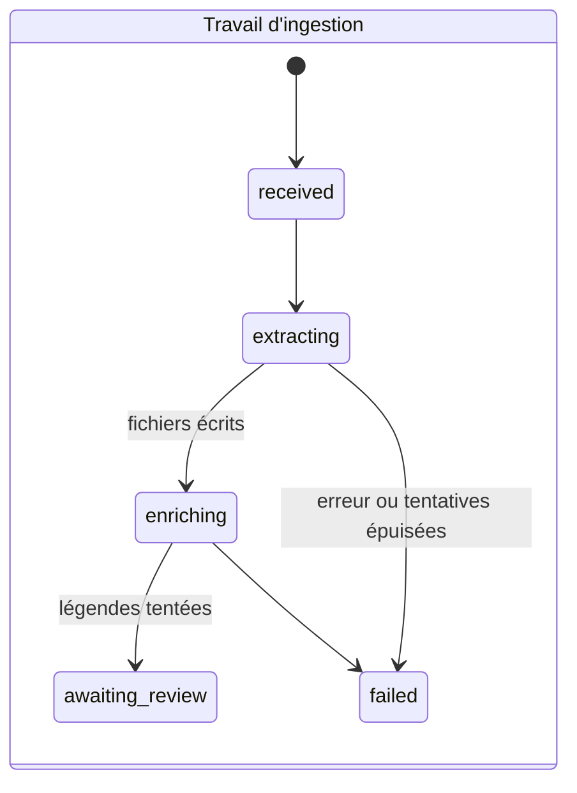
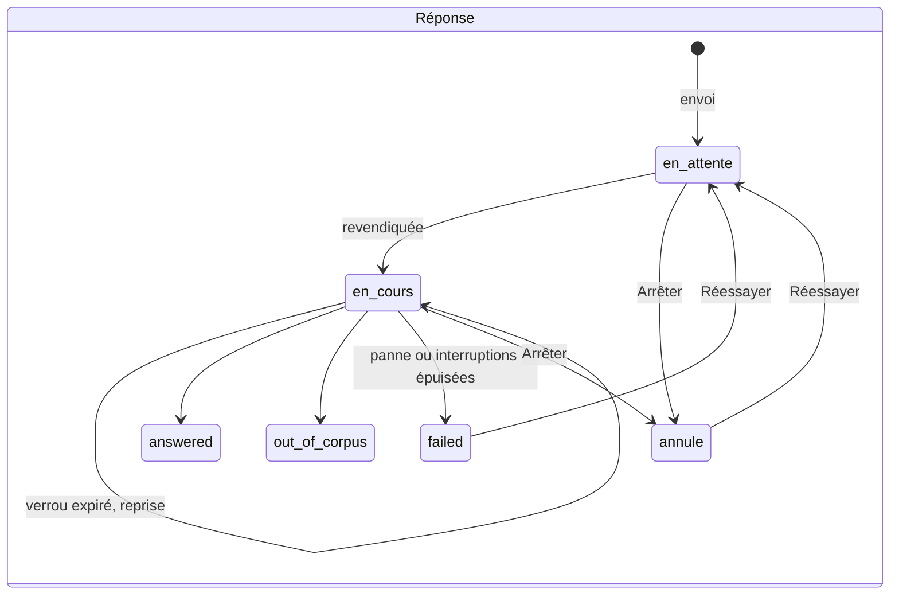
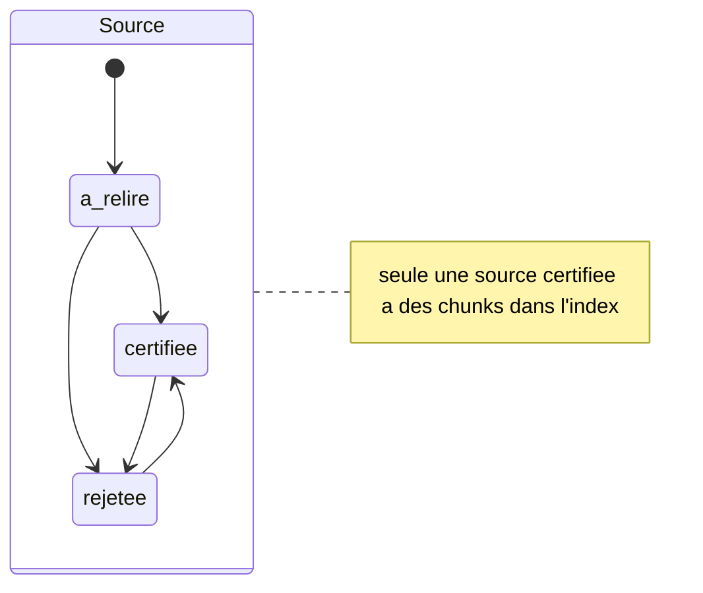
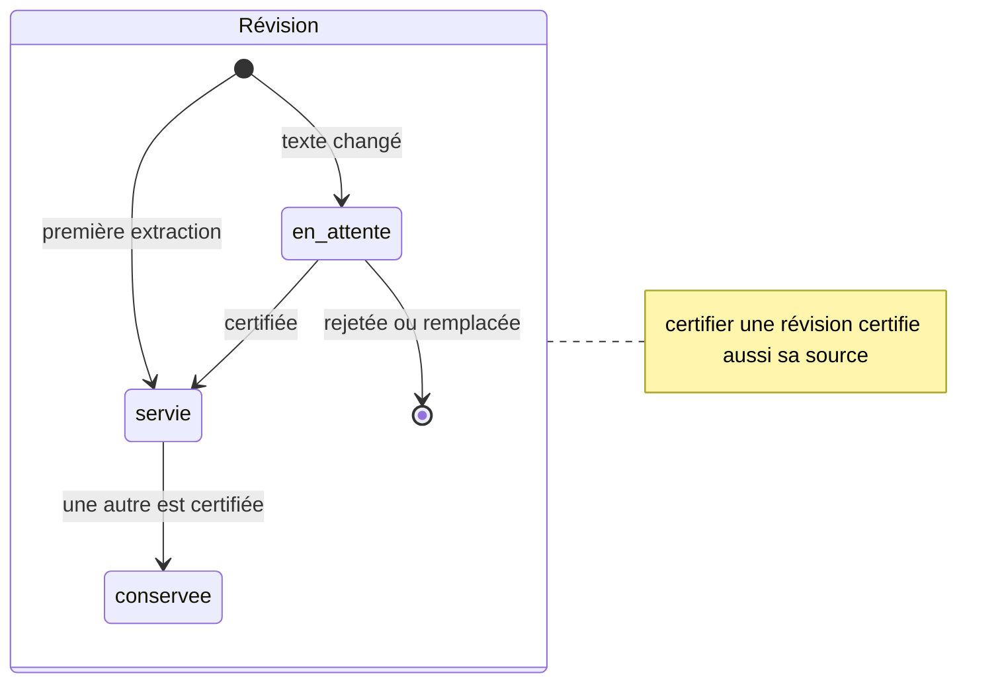
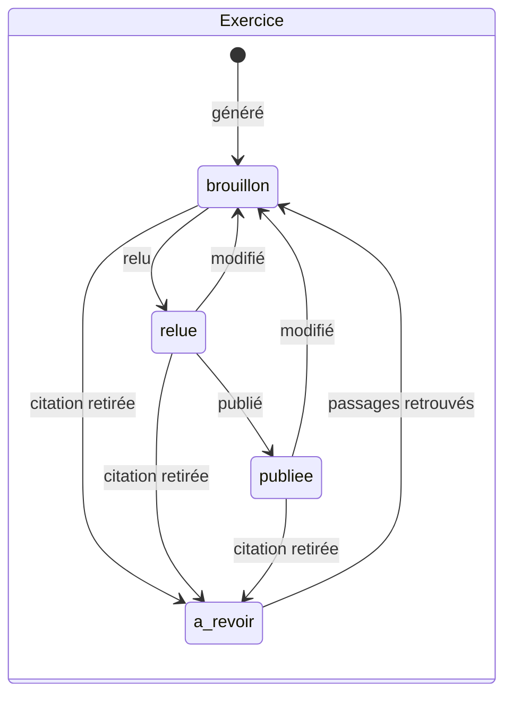
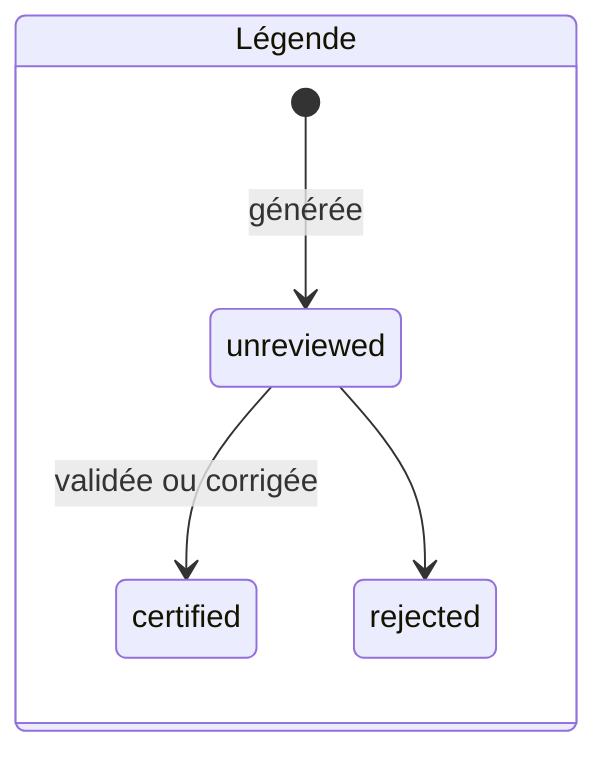

# Architecture

Ce document garde les règles que le code ne dit pas de lui-même. Les routes, le schéma, les
modèles et leurs réglages se lisent dans `src/app/routes.ts`, `migrations/` et
`src/app/config.ts`.

## Règles du produit

1. Une affirmation cite un passage retrouvé mot pour mot dans une source certifiée, que son
   lecteur peut lire et que Thot peut citer. `verifier()` dans `src/core/reponse.ts` le contrôle. Un
   juge (`juger()`, même fichier) contrôle ensuite que ce passage, lu sous le titre de son
   extrait, prouve toute la phrase. Un juge injoignable ou plus lent que 4 s laisse passer
   l'affirmation et le note au journal. La réponse affiche alors « Vérification partielle » au
   lieu de « Réponse vérifiée ». Le dépassement du délai annule la requête du juge.
   Avant publication et à chaque relecture d'un échange, les preuves sont contrôlées à nouveau,
   dans la révision que cite la réponse. Si une preuve ou son titre a changé, ou si le lecteur
   n'y a plus accès, la réponse est signalée comme indisponible et peut être recalculée. Une
   nouvelle révision ne rend pas indisponible une réponse qui cite l'ancienne.
2. Une légende d'image générée et non relue sert à la recherche. Elle ne sert pas de preuve et
   ne s'affiche pas à l'élève. Chaque chunk porte donc deux textes : `rappel` pour la recherche,
   `preuve` pour la citation.
3. Une panne ne ressemble pas à une limite du cours. Une question aboutit à `answered`,
   `out_of_corpus` (rien d'assez proche dans le cours, ou refus du modèle) ou `failed` (panne de
   fournisseur, sortie vide, citations introuvables).
4. Un contenu pédagogique généré (fiche, quiz, page de wiki) reste invisible aux élèves tant
   qu'un enseignant ne l'a pas certifié. Les questions suggérées font exception : le worker ne
   garde que celles auxquelles la chaîne de réponse répond avec des citations vérifiées, et pas
   celles qui renvoient à une image ou à un extrait que l'élève ne voit pas. Après un refus, le
   reclasseur ne laisse passer que les questions proches de la question refusée, au seuil de la
   recherche. Aucune n'est proposée si rien n'est proche ou si le reclasseur est en panne.
5. Le corpus reste lisible sans l'application. Chaque source vit dans
   `data/content/{source}/` : original, images, `document.txt` et `blocs.jsonl` de sa révision 1,
   puis `revisions/{n}/` pour chaque révision suivante. La base dit quelle révision sert.
   L'index de recherche se reconstruit depuis les révisions servies par `thot rebuild`.
6. Le `document.txt` d'une révision est le système de coordonnées de ses citations, et son texte
   ne change plus. Une extraction dont le texte diffère de la révision servie devient une
   révision en attente, vérifiée bloc par bloc. Elle ne sert qu'une fois certifiée par un
   enseignant, et l'index ne contient que la révision servie. Une ancienne révision se lit avec
   les mêmes droits que la source : retirer l'accès à la source la retire aussi.
   Les offsets comptent des points de code, les chaînes JavaScript des unités UTF-16. Tout
   découpage passe par `src/core/texte.ts`.
7. Le choix d'un modèle est un réglage d'environnement. Il ne traverse pas le domaine.

## Forme du système

Un monolithe Node.js lance deux processus depuis le même code. Le serveur Hono rend les pages et
calcule les réponses aux élèves. Le worker extrait les documents et génère légendes et questions
suggérées. Ils partagent `state.sqlite3`. Chaque file de travaux est une table SQLite avec un
verrou expirable : un processus tué reprend son travail au redémarrage.

Une question envoyée est un travail durable, porté par sa ligne de `messages`. La boucle de
réponses du serveur (`src/app/reponses.ts`) la calcule hors de toute connexion, avec un nombre
borné de réponses à la fois. Une longue extraction tourne dans le worker et ne retarde pas le chat.
Chaque revendication donne à la tentative un nouveau `generation_id`, et seule la tentative qui le
détient encore publie : une tentative expirée, arrêtée ou purgée n'écrit rien. Pendant le calcul,
la tentative renouvelle son verrou. Un renouvellement refusé interrompt son appel de modèle par
son `AbortSignal`. Avant de publier, la boucle revérifie les preuves avec les droits actuels de
l'élève. Une réponse interrompue plusieurs fois échoue avec la cause `INTERRUPTED`.

`src/core/` porte l'ingestion, la recherche et la réponse. Il n'importe rien de `src/app/`
(`pnpm frontiere`) et reçoit le périmètre des sources consultables en paramètre. Il ne reçoit
ni session ni requête HTTP.

Le dépôt accepte PDF, HTML, PNG, JPEG et Markdown. Le type vient du contenu, sauf le Markdown
qui n'a pas de signature : il demande l'extension `.md` ou `.markdown`, des octets UTF-8 valides
et aucun NUL. Son texte de preuve est celui que le lecteur voit une fois la page rendue : les
titres ATX (`#`) ouvrent les sections, les marques de lien et d'emphase disparaissent, les blocs de
code et `mermaid` restent mot pour mot. Le front matter fournit le titre, ses autres clés sont
ignorées. Les images liées ne sont pas jointes, un avertissement les nomme.

Le dépôt web prend plusieurs fichiers. Chacun passe par `deposer()` seul : une source, un travail
d'ingestion, aucune dépendance entre fichiers. Avec JavaScript, le navigateur envoie un fichier
par requête, trois à la fois. Sans JavaScript, le serveur dépose les fichiers d'une requête l'un
après l'autre et liste le sort de chacun. Les champs communs (matière, cours, lecteurs) valent
pour tout le lot. Le titre vient du fichier (front matter pour le Markdown, sinon le nom sans
extension), le nom saisi au formulaire ne vaut que pour un fichier seul.

- Un lot (`sources.lot_id`) groupe les fichiers d'un même formulaire. La bibliothèque le filtre
  par `/prof?lot=`. Le serveur refuse le fichier qui ferait dépasser `MAX_LOT` sources au lot, et
  chaque fichier de plus de `MAX_OCTETS`.
- Une clé de dépôt (`sources.cle_depot`) rend un renvoi inoffensif. Le navigateur en tire une par
  fichier, le formulaire sans JavaScript la déduit du lot et de la position. La même clé du même
  compte rend la source déjà créée, sans second travail. Un index unique tranche deux requêtes
  simultanées.
- Un fichier dont la somme de contrôle est celle d'une source que le compte peut lire est un
  doublon : rien n'est écrit et la réponse renvoie cette source. La recherche passe par
  `FILTRE_ACCES`, donc un fichier identique à une source privée d'un autre compte se dépose
  normalement et ne révèle pas qu'elle existe. L'import en ligne de commande compare, lui, toute
  l'instance.

## Instances

Une installation possède son identité persistante, ses comptes et son répertoire de données.
Deux installations partagent le code, jamais un volume applicatif. Renommer une installation ne
change ni son identité ni ses sources. L'ancien identifiant d'établissement est repris des sources
existantes, ou de l'environnement pour une base vide. Une base qui contient plusieurs
établissements exige une séparation explicite avant son initialisation.

Le nom et le mode d'usage sont enregistrés en base. Un administrateur renomme l'instance depuis
l'administration, le mode y reste en lecture seule. Chemins, origine, clés, fournisseurs autorisés
et localisations déclarées restent des réglages d'opérateur. La localisation affichée ne prouve
pas le lieu d'exécution du fournisseur. Désactiver un fournisseur interdit aussi son emploi en
repli, même si sa clé est présente.

Le mode personnel conserve les contrôles de relecture et de publication du pilote. Son propriétaire
peut gérer les documents et les étudier avec le même compte, sans classe obligatoire. Le mode est
choisi avant la création des comptes.
L'autorité d'administration est accordée explicitement par l'opérateur, jamais à tous les enseignants.

## Matières, cours et profils

Une instance a un seul profil d'import, partagé par ses matières et ses ressources. Un
établissement qui a besoin des deux profils fait tourner deux instances. Un cours regroupe des ressources avec un public et un
objectif facultatifs. Un thème appartient à un cours. Les identifiants, jamais les libellés,
séparent les thèmes homonymes. Renommer garde les identifiants, donc les rattachements. Une
matière, un cours ou un thème ne se supprime que si ni une ressource, ni une question d'élève,
ni un objectif d'apprentissage ne l'utilise. Les anciennes matières et séquences gardent leurs métadonnées,
leurs sources et leurs citations. Une matière absente reste non classée.

Le thème est le seul regroupement des ressources. Le dépôt choisit un thème pour chaque cours
coché. Les formulaires n'ont pas de champ libre « séquence ». La séquence reste lisible dans les
métadonnées des anciennes sources, et l'import CLI la remplit avec le nom du dossier. Elle range
la source dans le thème de même nom du cours, créé s'il manque. Le périmètre d'une question est
un thème, pas une séquence. Une adresse ou une page d'avant les thèmes qui nomme une séquence
mène au thème où sont rangées le plus de sources de cette séquence, dans un cours du compte
d'abord. Une question posée dans une séquence qu'aucun thème ne remplace est refusée.

L'en-tête de recherche de chaque passage (`rappel`) porte les noms des thèmes de la source, tous,
par ordre alphabétique. Une source sans thème garde sa séquence. Renommer un thème réindexe ses
sources. L'en-tête sert à la recherche et au reclasseur. Il n'entre ni dans `preuve` ni dans le
titre que voient le juge et l'élève.

Rattacher une source à plusieurs cours ne copie ni son original ni ses informations relues.
Son propriétaire, sa certification et ses lecteurs restent ceux de la source. Un rattachement
ouvre la source aux membres du cours, dans la limite de ses lecteurs. Un enseignant ne rattache
qu'à ses cours. Tout compte, administrateur compris, garde au moins un cours sur une source déjà
rattachée : sans cours, toute l'instance la lirait. Un dépôt sans cours coché se range dans le
premier cours de sa matière dont le déposant est membre. Sans un tel cours, il reste non classé.

Les profils fixes se lisent dans `src/core/profils.ts`. Le profil général garde un vocabulaire
neutre. Le profil arts conserve les rubriques ATC, les propositions de métadonnées artistiques
et le quiz d'identification. Il garde aussi les consignes de réponse, de juge, de suggestion et
de légende mesurées sur le pilote. La première matière fixe le profil de l'instance. Une seule
action le change pour toutes les matières, tant qu'aucune ressource n'a un autre profil. Ensuite,
l'administration et la CLI refusent une matière d'un autre profil. La source capture le profil au
dépôt, y compris sans matière. Une réextraction conserve ce profil.

Un profil est un préréglage de code. Il fixe les traitements construits ou mesurés pour lui et
fournit les termes et les champs du dépôt par défaut. Les réglages de l'administration
n'enregistrent que ce qui s'en écarte : un terme vide, ou une matière dont les champs n'ont jamais
été enregistrés, reprend le profil. Changer de profil avant le premier dépôt change ces valeurs
par défaut sans réécrire les réglages enregistrés. Un autre traitement demande un nouveau profil
en code, avec sa propre évaluation.

Les termes de niveau et de regroupement appartiennent à l'instance, pas à la matière : l'accueil
de l'élève et la bibliothèque montrent plusieurs matières sur une page. Un terme se règle au
singulier et au pluriel, sans genre. L'interface ne l'accorde donc avec aucun article ni
adjectif. Le terme de regroupement nomme les thèmes partout, administration comprise.

Les champs du dépôt appartiennent à chaque matière. Une matière coche des champs prédéfinis et
des champs personnalisés de l'instance, de type texte, date ou mots-clés. La valeur d'un champ
reste dans les métadonnées de la source, sous la clé du champ. Renommer le champ garde sa clé.
Ses valeurs suivent la validation des champs prédéfinis. Retirer un champ d'une matière le
masque des formulaires et de la lecture, sans effacer ses valeurs. Un champ personnalisé ne se
supprime que si aucune ressource ne porte de valeur pour lui. Une matière arts garde la date,
l'artiste et le mouvement, que lisent les propositions de Thot et le quiz.

Aucun réglage n'atteint un modèle : ni terme, ni nom ou valeur de champ. Les consignes viennent
du profil des sources retrouvées. Une consigne écrite pour un autre public modifie le profil et
rejoue l'évaluation.

Les lecteurs par défaut d'un dépôt s'appliquent aux dépôts suivants, par le web comme par la CLI.
Les ressources déposées gardent leurs lecteurs. Le mode personnel n'a pas ce réglage : un dépôt
n'y a qu'un lecteur.

Seuls les administrateurs modifient ces réglages. Chaque formulaire s'enregistre en entier ou
pas du tout. Les réglages de l'instance et la liste des champs de chaque matière portent une
version : un enregistrement parti d'une version périmée n'enregistre rien et rend la saisie avec
la version actuelle.

La langue décrit la source, pas sa matière ou son niveau. La recherche conserve sa racinisation
française. Les autres langues sont signalées comme non prises en charge. La sonde lexicale de
`tests/domaines_test.ts` ne qualifie ni le reclasseur ni les modèles pour l'anglais.

## Lecteurs et propriétaire

Une source appartient au compte qui l'a déposée. Ses lecteurs sont son propriétaire seul, les
enseignants, ou les enseignants et les élèves. Les administrateurs lisent et gèrent toutes les
sources, y compris celles sans propriétaire. Un élève ne lit que les sources certifiées. Thot cite
une source dans une réponse seulement si la case « Thot s'en sert pour répondre » est cochée : une
source peut se lire sans servir de preuve. La recherche de la bibliothèque montre toute source
certifiée lisible.

Les membres d'un cours sont ses enseignants et ses élèves. Une source partagée avec les enseignants
se lit par les enseignants membres de ses cours, une source publiée aux élèves par tous leurs
membres. Une source sans cours garde l'audience de toute l'instance. Le propriétaire et les
administrateurs lisent sans être membres.

`FILTRE_ACCES` dans `src/core/recherche.ts` porte cette règle. La recherche, les pages de lecture,
les images, les filtres de cours et la relecture des réponses l'appliquent avec le compte qui lit.
Retirer un membre retire l'accès à la prochaine requête, y compris à la revalidation des preuves
d'une ancienne réponse. Un appel avec `lecteur: null`, comme la génération de suggestions par le
worker ou les évaluations en ligne de commande, voit les sources publiées aux élèves de tous les
cours.

Le propriétaire et les administrateurs modifient une source, la certifient et relisent ses
légendes. Les enseignants de ses cours le font aussi quand elle n'est pas privée. Les questions
suggérées et le fait de l'accueil suivent le lecteur. Un cours ne se nomme qu'à ses membres, et un
élève ne pose une question dans un cours que s'il en est membre. `/prof/questions` montre à un
enseignant les échanges de ses cours. Une comparaison va aux enseignants des cours de ses
matières. Un échange sans cours va aux enseignants qui partagent un
cours avec l'élève, ou à tous s'il n'en a aucun. Un enseignant ne voit et ne réinitialise que les
élèves qui partagent un de ses cours. Seuls les administrateurs gèrent les élèves sans cours. Un
enseignant crée les élèves de ses cours, chacun inscrit à au moins un, et les en retire. Il
n'inscrit pas un compte existant :
l'inscription lui donnerait la réinitialisation de son mot de passe, donc le compte. Un élève qui a
déjà un compte rejoint un cours en ouvrant lui-même un lien d'inscription. Le lien inscrit des
élèves seulement, aux cours dont son créateur est encore membre. Sa page nomme ces cours à
quiconque détient le lien. Après la connexion, l'adresse de retour n'accepte qu'un lien
d'inscription. Les administrateurs lisent tout. Une image se revalide à chaque affichage : un accès
retiré s'applique aussitôt.

Le nom de déposant d'une source importée ou migrée désigne son propriétaire quand un seul
enseignant le porte. Sinon, la source reste sans propriétaire et le nom reste affiché.

## Rejeter et supprimer une source

Rejeter retire la source de l'index et des élèves. Ses fichiers, ses images et les réponses qui la
citent restent, et elle peut être certifiée de nouveau. Supprimer est définitif, pour un droit
d'auteur, une erreur ou une demande RGPD. Seuls son propriétaire et les administrateurs la
suppriment. Les enseignants de ses cours la modifient et la rejettent, mais ne suppriment pas un
original qu'ils n'ont pas déposé. Le web et `thot supprimer source` passent par
`supprimerSource()` dans `src/app/ingestion.ts`.

Une transaction retire la ligne de la source et tout ce qui en dérive : révisions, chunks et index
plein texte, images et légendes, rattachements, suggestions, travail d'ingestion et légendes en
cache. Le dossier `data/content/{source}/` part ensuite. Une réponse conservée perd les
affirmations qui citent la source. Sans affirmation, elle devient indisponible avec « Une source
citée a été supprimée. », et l'élève peut la relancer. Une réponse à plusieurs sources garde les
autres affirmations, chacune avec sa citation, en un paragraphe, et dit qu'une partie a été
retirée. Ses blocs disparaissent : leurs titres viennent du modèle sans preuve et ont pu nommer la
source. Le journal perd les candidats de la source et les sorties du modèle, qui recopient les
extraits. Questions et titres de conversation restent : ils viennent de l'élève.

Une réponse en cours qui a retrouvé la source ne publie rien d'elle. La revérification avant
publication la rend indisponible, et la boucle retire du journal les sources supprimées pendant le
calcul. Une suggestion en cours échoue sur la clé étrangère. La suppression est refusée tant que
le worker extrait la source sous un verrou valide : il réécrirait ses fichiers et le cache.

Le texte de la source quitte aussi le fichier de la base : `secure_delete` sur chaque connexion,
l'option `secure-delete` de l'index plein texte (migration 0017), puis un point de contrôle qui
vide le WAL. Une légende en cache se retrouve par l'empreinte de sa requête, calculée sur les
octets de l'image et le modèle de légende actuel. Une légende mise en cache sous un autre modèle,
ou pour une image qu'une réextraction a remplacée, reste dans `cache_modeles`. Les sauvegardes et
les rapports d'évaluation de `data/evaluation/` ne sont pas touchés
([exploitation](exploitation.md#données-personnelles)).

## Activités sourcées

Une activité est un exercice à réponse courte ou une explication d'étude. Un objectif
d'apprentissage appartient à un cours. Sa référence (référentiel ou programme,
compétence et version) reste un texte libre que Thot n'interprète pas : rien ne déduit qu'un
document couvre un objectif.

Un enseignant prépare un exercice à réponse courte depuis un objectif et une à quatre sources
certifiées du cours, publiées à ses élèves et utilisées par Thot pour répondre. Un appel du
générateur rédige la consigne, la réponse attendue, deux à cinq critères et le retour
(`src/core/activite.ts`). Chaque champ cite des passages que `verifier()` retrouve mot pour mot
dans l'extrait désigné, avec la révision et les offsets de leur source. Un champ dont une citation
ne se retrouve pas, ou ne se retrouve que dans une légende d'image, est rejeté et compté, comme le
prévoit l'ADR 0002. Sans consigne, réponse attendue, retour et deux critères ancrés, rien n'est
enregistré, pas même un nouvel objectif.

Une citation retrouvée ne prouve que son passage : un premier essai réel gardait un retour qui en
disait plus que ses citations. Le juge de soutien des réponses lit donc chaque champ gardé contre
ses passages mis bout à bout, un appel par champ, avec la consigne du profil général et
`SEUIL_SOUTIEN`. Il ne rejette rien. Un champ qu'il ne soutient pas est « À vérifier » dans la page
de l'enseignant, et un juge en panne ou trop lent laisse « Juge indisponible ». L'avis est enregistré
dans le champ, avec la version : afficher la page ne rappelle pas le juge. Une modification fait
juger les champs dont le texte ou les passages changent, et ceux restés sans avis. Publier ne
demande pas l'avis du juge : la relecture de l'enseignant reste la barrière.

Une explication part du même choix de cours, d'objectif et de sources. Thot pose l'objectif comme
une question à `demander()`, dans les sources choisies seulement (`Perimetre.sources`). L'explication
garde la réponse vérifiée : affirmations, citations avec la révision de leur source, blocs, et l'avis
du juge que `demander()` applique déjà à chaque phrase. Hors corpus ou en panne, rien n'est
enregistré. L'élève la lit comme une réponse, avec la feuille du passage cité, sans tentative ni
corrigé. Elle ne se modifie pas : l'enseignant en prépare une autre.

Une activité est brouillon, relue, publiée ou à revoir. Une relecture vaut pour une version de
l'activité. Chaque modification crée une version en brouillon, et la relecture précédente ne vaut
plus pour elle. Une relecture, une publication ou une modification partie d'une version périmée est
refusée. Publier demande une version relue et des preuves qui tiennent encore. L'historique garde
qui a relu, publié ou modifié chaque version, et quand.

Un élève pratique les exercices publiés des cours dont il est membre. Avant sa réponse, la page ne
contient que l'objectif et la consigne. La réponse attendue, les critères, le retour et les passages
cités ne sortent du serveur qu'avec une tentative de ce compte sur la version actuelle. L'élève
coche ensuite les critères que sa réponse remplit. Thot ne note pas la réponse et ne la compare à
aucun texte.

Une citation tient tant qu'elle vise la révision servie d'une source certifiée, rattachée au cours,
publiée à ses élèves et utilisée par Thot. `statuer()`, `supprimerSource()` et les changements de
lecteurs ou de cours d'une source signalent à revoir les activités dont une citation ne tient plus.
La page de l'élève revérifie les citations à chaque affichage. Une activité à revoir n'est plus
servie. L'enseignant enregistre de nouveau un exercice, ce qui recherche chaque passage dans la
révision servie, puis le relit. Une tentative garde la version de l'exercice à laquelle elle
répondait.

Supprimer une source retire de chaque exercice ses passages et le texte des champs qui les citaient,
rédigés d'après elle. Une explication perd les phrases qui la citaient, et ses blocs, dont les titres
ont pu nommer la source. L'activité devient à revoir. Les réponses des élèves restent : elles viennent
d'eux, et suivent la purge de `THOT_RETENTION_JOURS`.

En mode personnel, une activité reste privée à son auteur, cours compris. Il la relit et la publie
pour lui-même, et la page dit que personne d'autre ne l'a relue.

## Conversations

Une conversation appartient au compte qui l'a ouverte. Pour tout autre compte, son adresse, ses
actions et ses échanges répondent 404, comme un identifiant inconnu : afficher, renommer,
archiver, désarchiver, changer de périmètre, envoyer, relancer, arrêter, donner un avis, suivre le
flux et ouvrir une citation. Son titre reste privé : `/prof/questions` liste les échanges un par
un, selon les cours de l'enseignant, sans passer par la conversation.

La liste se filtre par le titre ou le texte d'une question (`?q=`, LIKE sans joker). Les
conversations archivées ne sortent que de leur propre vue. Le navigateur garde, par compte et par
conversation et le temps de l'onglet, le brouillon, la position de lecture et le passage ouvert.
Sans `sessionStorage`, la page marche sans cette mémoire.

Chaque échange garde le périmètre qu'il a utilisé. Changer le périmètre d'une conversation vaut
pour les questions suivantes, et chaque envoi revérifie que l'élève peut encore interroger ce
périmètre. La recherche d'une question ne reprend que la question précédente de la même
conversation, si elle a été posée dans le même périmètre. Rien ne passe d'une conversation à une
autre, ni d'un périmètre restreint à un périmètre plus large.

Un périmètre peut aussi comparer deux à quatre matières entières, cochées dans le formulaire
« Changer ». Une seule case cochée vaut le périmètre de cette matière. Chaque matière comparée doit
offrir au lecteur une source lisible, sinon le périmètre est refusé. La conversation et chacun de
ses échanges gardent la liste des matières comparées.

Une conversation porte une réponse à la fois, ce qui garde l'ordre de ses tours. Un envoi pendant
une réponse, ou dans une conversation archivée, reçoit 409 et l'élève garde sa saisie. Un envoi
rejoué avec la même clé retrouve son premier échange. Une conversation vidée par la purge
disparaît avec son titre, qui reprend souvent une question. Une réponse en cours perd alors sa
ligne : sa tentative s'interrompt et ne recrée rien.

La réponse continue quand l'élève ferme la page. Le flux SSE lit l'étape enregistrée, puis la
réponse : le fermer n'arrête ni ne relance le calcul, et une reconnexion repart de l'état
enregistré. « Arrêter » marque la réponse arrêtée et interrompt son appel de modèle. La question
reste et se relance avec « Réessayer ». La liste relit le statut d'une réponse en file ou en cours
sans déplacer le focus. Elle marque « Nouvelle réponse » une réponse terminée que l'élève n'a pas
vue, jusqu'à l'ouverture de sa conversation.

## États

## Réponse à une question

Le seuil d'abstention est une probabilité du reclasseur et ne s'applique pas aux rangs FTS5. En
panne du reclasseur, le générateur et le juge décident seuls. Leur refus donne `failed`, car des
extraits mal triés ne prouvent pas que le cours est muet.

L'affirmation reste l'unité de preuve. Le profil général peut ranger les affirmations d'une
réponse en blocs : paragraphe, liste, étapes ou tableau. Un bloc ne désigne que des affirmations
vérifiées, donc chaque étape, élément ou case de tableau garde sa citation. Les titres de blocs,
de colonnes et de lignes viennent du modèle sans preuve et restent courts. Un tableau juxtapose
des cases vérifiées une à une et n'affirme aucune relation entre elles : une relation est une
affirmation avec sa propre citation. `ranger()` dans `src/core/reponse.ts` borne la structure.
Une structure invalide donne un seul paragraphe, une affirmation refusée quitte son bloc. Une
réponse sans blocs, comme toutes celles d'avant, se lit en un paragraphe. Les réponses d'arts
appliqués restent plates : leur consigne mesurée ne demande pas de blocs.

### Comparaison de matières

Pour une comparaison, `chercher()` interroge chaque matière à part, avec le filtre d'accès du
lecteur. Les 20 candidats FTS5 se partagent à parts égales entre les matières, et un seul
reclassement ordonne leur union. Seuls les extraits au-dessus du seuil servent. Le meilleur extrait
de chaque matière prend une des cinq places, les meilleurs restants complètent les autres : une
grande matière ne prend pas toutes les places. Un chunk trouvé dans deux matières porte les deux
noms.

Le modèle ne complète pas une matière sans extrait au-dessus du seuil. La réponse affiche
« Aucun passage trouvé en {matière}. » et le journal note la matière sous `sans_passage`. Sans
extrait dans aucune matière, la question est `out_of_corpus`.

Les extraits donnés au générateur nomment leur matière en comparaison seulement, et la consigne du
profil général y gagne une règle : une colonne de tableau par matière. Les questions d'une seule
matière gardent le format et les consignes mesurés. Chaque affirmation garde sa source, et la
réponse affiche la matière de cette source à côté de sa citation. Le titre d'une colonne vient du
modèle et ne prouve pas la matière.

## Règles de travail

- Les tests n'appellent pas de modèle.
- Un changement d'extraction, de découpage, de modèle ou de seuil rejoue l'évaluation concernée
  (`evaluation/`).
- Le corpus de l'établissement reste hors du dépôt. Les fixtures sont petites et autorisées.
- Un échec reste visible avec sa cause. Il ne devient pas un avertissement générique.

## Hors périmètre du pilote

Une instance sert un établissement, un département ou un usage personnel. Restent hors périmètre :
index vectoriel approximatif, contexte complet envoyé au modèle, base ou file distribuée, consensus entre modèles à
l'extraction, recherche web, mode hors ligne, DOCX et PPTX tant que personne n'en dépose.
