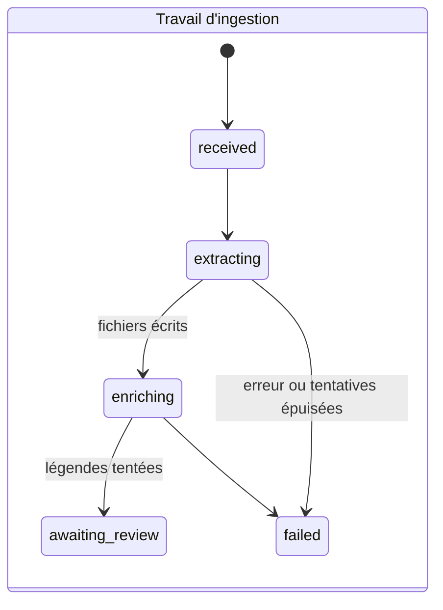
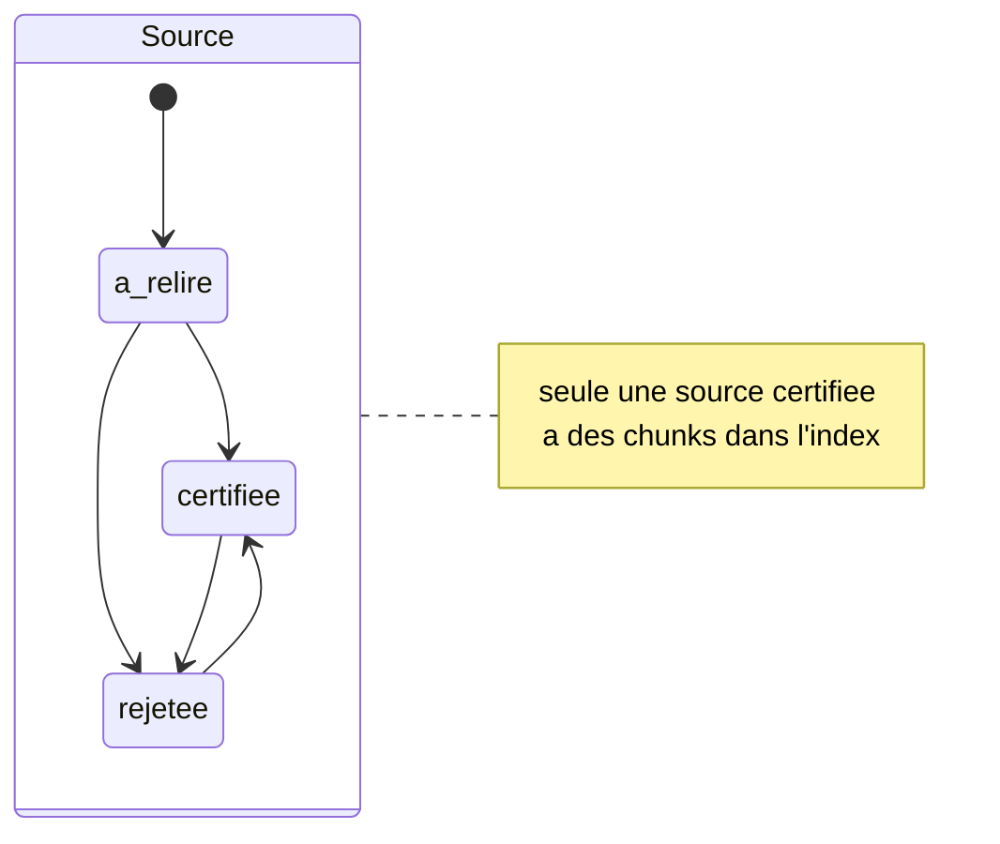
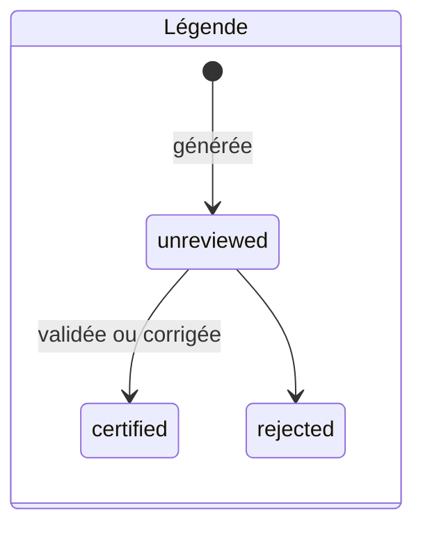
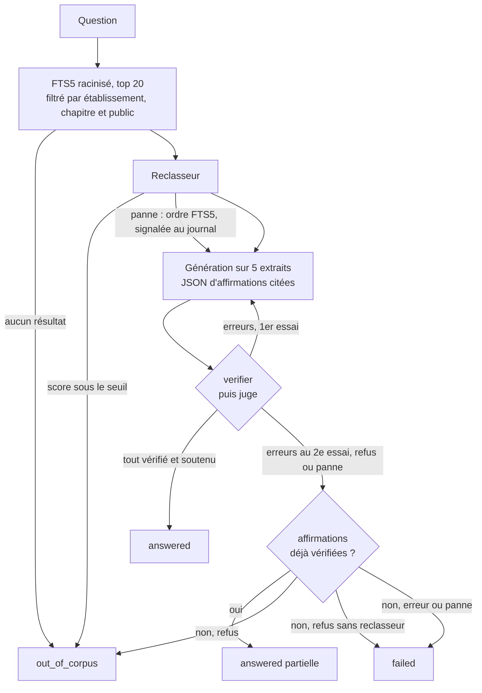

# Architecture

Ce document garde les règles que le code ne dit pas de lui-même. Les routes, le schéma, les
modèles et leurs réglages se lisent dans `src/app/routes.ts`, `migrations/` et
`src/app/config.ts`.

## Règles du produit

1. Une affirmation cite un passage retrouvé mot pour mot dans une source certifiée, que son
   lecteur peut lire et que Thot peut citer. `verifier()` dans `src/core/reponse.ts` le contrôle. Un
   juge (`juger()`, même fichier) contrôle ensuite que ce passage, lu sous le titre de son
   extrait, prouve toute la phrase. Un juge injoignable ou plus lent que 4 s laisse passer
   l'affirmation et le note au journal. Le dépassement du délai annule la requête du juge.
   Avant publication et à chaque relecture d'un échange, les preuves sont contrôlées à nouveau.
   Si une preuve ou son titre a changé, ou si le lecteur n'y a plus accès, la réponse est
   signalée comme indisponible et peut être recalculée.
2. Une légende d'image générée et non relue sert à la recherche. Elle ne sert pas de preuve et
   ne s'affiche pas à l'élève. Chaque chunk porte donc deux textes : `rappel` pour la recherche,
   `preuve` pour la citation.
3. Une panne ne ressemble pas à une limite du cours. Une question aboutit à `answered`,
   `out_of_corpus` (rien d'assez proche dans le cours, ou refus du modèle) ou `failed` (panne de
   fournisseur, sortie vide, citations introuvables).
4. Un contenu pédagogique généré (fiche, quiz, page de wiki) reste invisible aux élèves tant
   qu'un enseignant ne l'a pas certifié. Les questions suggérées font exception : le worker ne
   garde que celles auxquelles la chaîne de réponse répond avec des citations vérifiées.
5. Le corpus reste lisible sans l'application. Chaque source vit dans
   `data/content/{source}/` : original, `document.txt`, `blocs.jsonl`, images. L'index de
   recherche se reconstruit depuis ces fichiers par `thot rebuild`.
6. `document.txt` est le système de coordonnées des citations. Les offsets comptent des points
   de code, les chaînes JavaScript des unités UTF-16. Tout découpage passe par
   `src/core/texte.ts`.
7. Le choix d'un modèle est un réglage d'environnement. Il ne traverse pas le domaine.

## Forme du système

Un monolithe Node.js lance deux processus depuis le même code : le serveur Hono, qui rend les pages
et calcule les réponses pendant le flux SSE de l'élève, et le worker, qui extrait les documents
et génère légendes et questions suggérées. Ils partagent `state.sqlite3`. La file de travaux est
une table SQLite avec un verrou expirable : un worker tué reprend le travail au redémarrage.

`src/core/` porte l'ingestion, la recherche et la réponse. Il n'importe rien de `src/app/`
(`pnpm frontiere`) et reçoit le périmètre des sources consultables en paramètre. Il ne reçoit
ni session ni requête HTTP.

Le dépôt accepte PDF, HTML, PNG, JPEG et Markdown. Le type vient du contenu, sauf le Markdown
qui n'a pas de signature : il demande l'extension `.md` ou `.markdown`, des octets UTF-8 valides
et aucun NUL. Son texte de preuve est celui que le lecteur voit une fois la page rendue : les
titres ATX (`#`) ouvrent les sections, les marques de lien et d'emphase disparaissent, les blocs de
code et `mermaid` restent mot pour mot. Le front matter fournit le titre, ses autres clés sont
ignorées. Les images liées ne sont pas jointes, un avertissement les nomme.

## Instances

Une installation possède son identité persistante, ses comptes et son répertoire de données.
Deux installations partagent le code, jamais un volume applicatif. Renommer une installation ne
change ni son identité ni ses sources. L'ancien identifiant d'établissement est repris des sources
existantes, ou de l'environnement pour une base vide. Une base qui contient plusieurs
établissements exige une séparation explicite avant son initialisation.

Le nom et le mode d'usage sont enregistrés en base. Chemins, origine, clés, fournisseurs autorisés
et localisations déclarées restent des réglages d'opérateur. La localisation affichée ne prouve
pas le lieu d'exécution du fournisseur. Désactiver un fournisseur interdit aussi son emploi en
repli, même si sa clé est présente.

Le mode personnel conserve les contrôles de relecture et de publication du pilote. Son propriétaire
peut gérer les documents et les étudier avec le même compte, sans classe obligatoire. Le mode est
choisi avant la création des comptes.
L'autorité d'administration est accordée explicitement par l'opérateur, jamais à tous les enseignants.

## Matières, cours et profils

Une instance a un seul profil d'import, partagé par ses matières et ses ressources. Un
établissement qui a besoin des deux profils fait tourner deux instances. Un cours regroupe des ressources avec un public et un
objectif facultatifs. Un thème appartient à un cours. Les identifiants, jamais les libellés,
séparent les thèmes homonymes. Renommer garde les identifiants, donc les rattachements. Une
matière, un cours ou un thème ne se supprime que si ni une ressource ni une question d'élève ne
l'utilise. Les anciennes matières et séquences gardent leurs métadonnées,
leurs sources et leurs citations. Une matière absente reste non classée.

Rattacher une source à plusieurs cours ne copie ni son original ni ses informations relues.
Son propriétaire, sa certification et ses lecteurs restent ceux de la source. Un rattachement
ouvre la source aux membres du cours, dans la limite de ses lecteurs. Un enseignant ne rattache
qu'à ses cours. Tout compte, administrateur compris, garde au moins un cours sur une source déjà
rattachée : sans cours, toute l'instance la lirait. Un dépôt sans cours coché se range dans le
premier cours de sa matière dont le déposant est membre. Sans un tel cours, il reste non classé.

Les profils fixes se lisent dans `src/core/profils.ts`. Le profil général garde un vocabulaire
neutre. Le profil arts conserve les rubriques ATC, les propositions de métadonnées artistiques
et le quiz d'identification. Il garde aussi les consignes de réponse, de juge, de suggestion et
de légende mesurées sur le pilote. La première matière fixe le profil de l'instance. Une seule
action le change pour toutes les matières, tant qu'aucune ressource n'a un autre profil. Ensuite,
l'administration et la CLI refusent une matière d'un autre profil. La source capture le profil au
dépôt, y compris sans matière. Une réextraction
conserve ce profil et refuse de déplacer les citations si le texte change.

La langue décrit la source, pas sa matière ou son niveau. La recherche conserve sa racinisation
française. Les autres langues sont signalées comme non prises en charge. La sonde lexicale de
`tests/domaines_test.ts` ne qualifie ni le reclasseur ni les modèles pour l'anglais.

## Lecteurs et propriétaire

Une source appartient au compte qui l'a déposée. Ses lecteurs sont son propriétaire seul, les
enseignants, ou les enseignants et les élèves. Les administrateurs lisent et gèrent toutes les
sources, y compris celles sans propriétaire. Un élève ne lit que les sources certifiées. Thot cite
une source dans une réponse seulement si la case « Thot s'en sert pour répondre » est cochée : une
source peut se lire sans servir de preuve. La recherche de la bibliothèque montre toute source
certifiée lisible.

Les membres d'un cours sont ses enseignants et ses élèves. Une source partagée avec les enseignants
se lit par les enseignants membres de ses cours, une source publiée aux élèves par tous leurs
membres. Une source sans cours garde l'audience de toute l'instance. Le propriétaire et les
administrateurs lisent sans être membres.

`FILTRE_ACCES` dans `src/core/recherche.ts` porte cette règle. La recherche, les pages de lecture,
les images, les filtres de cours et la relecture des réponses l'appliquent avec le compte qui lit.
Retirer un membre retire l'accès à la prochaine requête, y compris à la revalidation des preuves
d'une ancienne réponse. Un appel avec `lecteur: null`, comme la génération de suggestions par le
worker ou les évaluations en ligne de commande, voit les sources publiées aux élèves de tous les
cours.

Le propriétaire et les administrateurs modifient une source, la certifient et relisent ses
légendes. Les enseignants de ses cours le font aussi quand elle n'est pas privée. Les questions
suggérées et le fait de l'accueil suivent le lecteur. Un cours ne se nomme qu'à ses membres, et un
élève ne pose une question dans un cours que s'il en est membre. `/prof/questions` montre à un
enseignant les échanges de ses cours. Un échange sans cours va aux enseignants qui partagent un
cours avec l'élève, ou à tous s'il n'en a aucun. Un enseignant ne voit et ne réinitialise que les
élèves qui partagent un de ses cours. Seuls les administrateurs gèrent les élèves sans cours. Un
enseignant crée les élèves de ses cours, chacun inscrit à au moins un, et les en retire. Il
n'inscrit pas un compte existant :
l'inscription lui donnerait la réinitialisation de son mot de passe, donc le compte. Un élève qui a
déjà un compte rejoint un cours en ouvrant lui-même un lien d'inscription. Le lien inscrit des
élèves seulement, aux cours dont son créateur est encore membre. Sa page nomme ces cours à
quiconque détient le lien. Après la connexion, l'adresse de retour n'accepte qu'un lien
d'inscription. Les administrateurs lisent tout. Une image se revalide à chaque affichage : un accès
retiré s'applique aussitôt.

Le nom de déposant d'une source importée ou migrée désigne son propriétaire quand un seul
enseignant le porte. Sinon, la source reste sans propriétaire et le nom reste affiché.

## États

## Réponse à une question

Le seuil d'abstention est une probabilité du reclasseur et ne s'applique pas aux rangs FTS5. En
panne du reclasseur, le générateur et le juge décident seuls. Leur refus donne `failed`, car des
extraits mal triés ne prouvent pas que le cours est muet.

## Règles de travail

- Les tests n'appellent pas de modèle.
- Un changement d'extraction, de découpage, de modèle ou de seuil rejoue l'évaluation concernée
  (`evaluation/`).
- Le corpus de l'établissement reste hors du dépôt. Les fixtures sont petites et autorisées.
- Un échec reste visible avec sa cause. Il ne devient pas un avertissement générique.

## Hors périmètre du pilote

Une instance sert un établissement, un département ou un usage personnel. Restent hors périmètre :
index vectoriel approximatif, contexte complet envoyé au modèle, base ou file distribuée, consensus entre modèles à
l'extraction, recherche web, mode hors ligne, DOCX et PPTX tant que personne n'en dépose.
