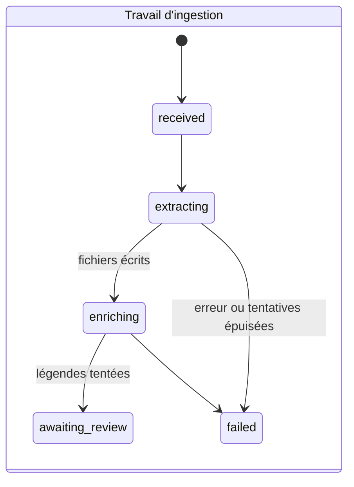
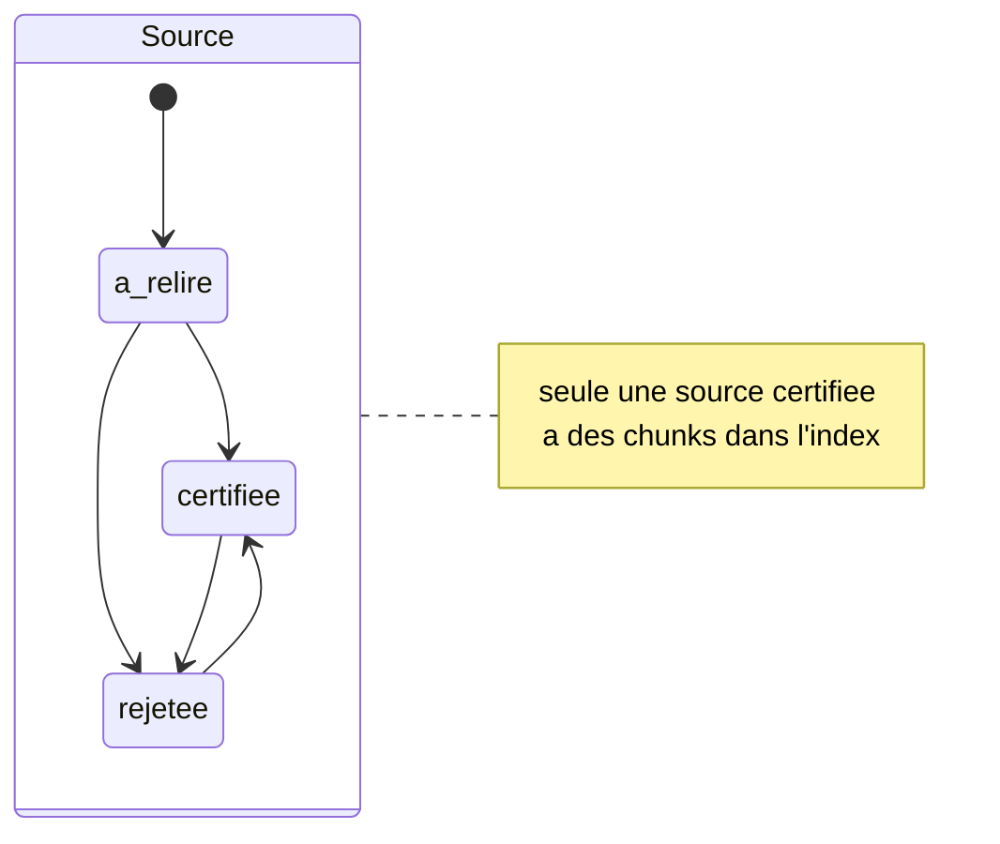
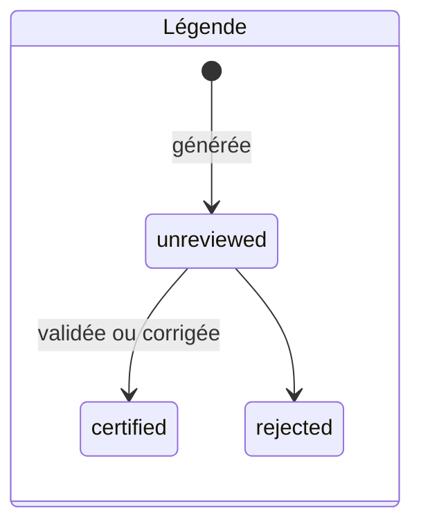
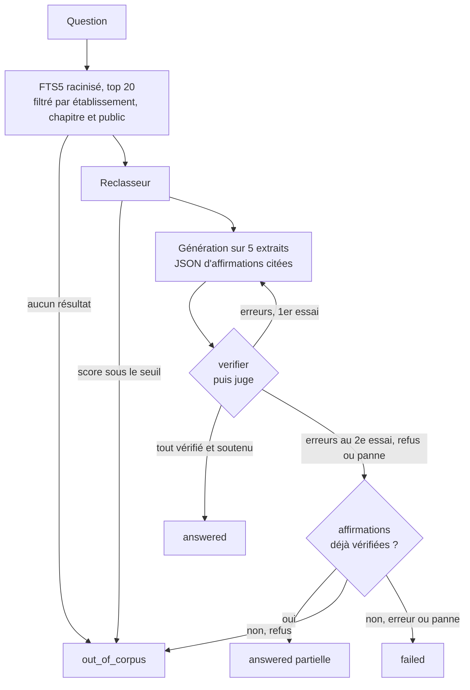

# Architecture

Ce document garde les règles que le code ne dit pas de lui-même. Les routes, le schéma, les
modèles et leurs réglages se lisent dans `src/app/routes.ts`, `migrations/` et
`src/app/config.ts`.

## Règles du produit

1. Une affirmation montrée à un élève cite un passage retrouvé mot pour mot dans une source
   certifiée et ouverte aux élèves. `verifier()` dans `src/core/reponse.ts` le contrôle. Un
   juge (`juger()`, même fichier) contrôle ensuite que ce passage, lu sous le titre de son
   extrait, prouve toute la phrase. Un juge injoignable ou plus lent que 4 s laisse passer
   l'affirmation et le note au journal. Le dépassement du délai annule la requête du juge.
   Avant publication et à chaque relecture d'un échange, les preuves sont contrôlées à nouveau.
   Si une preuve ou son titre a changé, ou si son accès est retiré, la réponse est signalée
   comme indisponible et peut être recalculée.
2. Une légende d'image générée et non relue sert à la recherche. Elle ne sert pas de preuve et
   ne s'affiche pas à l'élève. Chaque chunk porte donc deux textes : `rappel` pour la recherche,
   `preuve` pour la citation.
3. Une panne ne ressemble pas à une limite du cours. Une question aboutit à `answered`,
   `out_of_corpus` (rien d'assez proche dans le cours, ou refus du modèle) ou `failed` (panne de
   fournisseur, sortie vide, citations introuvables).
4. Un contenu pédagogique généré (fiche, quiz, page de wiki) reste invisible aux élèves tant
   qu'un enseignant ne l'a pas certifié. Les questions suggérées font exception : le worker ne
   garde que celles auxquelles la chaîne de réponse répond avec des citations vérifiées.
5. Le corpus reste lisible sans l'application. Chaque source vit dans
   `data/content/{source}/` : original, `document.txt`, `blocs.jsonl`, images. L'index de
   recherche se reconstruit depuis ces fichiers par `thot rebuild`.
6. `document.txt` est le système de coordonnées des citations. Les offsets comptent des points
   de code, les chaînes JavaScript des unités UTF-16. Tout découpage passe par
   `src/core/texte.ts`.
7. Le choix d'un modèle est un réglage d'environnement. Il ne traverse pas le domaine.

## Forme du système

Un monolithe Deno lance deux processus depuis le même code : le serveur Hono, qui rend les pages
et calcule les réponses pendant le flux SSE de l'élève, et le worker, qui extrait les documents
et génère légendes et questions suggérées. Ils partagent `state.sqlite3`. La file de travaux est
une table SQLite avec un verrou expirable : un worker tué reprend le travail au redémarrage.

`src/core/` porte l'ingestion, la recherche et la réponse. Il n'importe rien de `src/app/`
(`deno task frontiere`) et reçoit le périmètre des sources consultables en paramètre. Il ne reçoit
ni session ni requête HTTP.

## Instances

Une installation possède son identité persistante, ses comptes et son répertoire de données.
Deux installations partagent le code, jamais un volume applicatif. Renommer une installation ne
change ni son identité ni ses sources. L'ancien identifiant d'établissement est repris des sources
existantes, ou de l'environnement pour une base vide. Une base qui contient plusieurs
établissements exige une séparation explicite avant son initialisation.

Le nom et le mode d'usage sont enregistrés en base. Chemins, origine, clés, fournisseurs autorisés
et localisations déclarées restent des réglages d'opérateur. La localisation affichée ne prouve
pas le lieu d'exécution du fournisseur. Désactiver un fournisseur interdit aussi son emploi en
repli, même si sa clé est présente.

Le mode personnel conserve les contrôles de relecture et de publication du pilote. Son propriétaire
peut gérer les documents et les étudier avec le même compte, sans classe obligatoire. Le mode est
choisi avant la création des comptes.
L'autorité d'administration est accordée explicitement par l'opérateur, jamais à tous les enseignants.

## Matières, cours et profils

Une matière choisit un profil d'import. Un cours regroupe des ressources avec un public et un
objectif facultatifs. Un thème appartient à un cours. Les identifiants, jamais les libellés,
séparent les thèmes homonymes. Les anciennes matières et séquences gardent leurs métadonnées,
leurs sources et leurs citations. Une matière absente reste non classée.

Rattacher une source à plusieurs cours ne copie ni son original ni ses informations relues.
Son déposant, sa certification et ses publics restent ceux de la source. Un rattachement ne
publie rien. Les contrôles de lecture et d'éligibilité aux réponses du pilote restent applicables
avant la recherche et sur les lecteurs.

Les profils fixes se lisent dans `src/core/profils.ts`. Le profil général garde un vocabulaire
neutre. Le profil arts conserve les rubriques ATC, les propositions de métadonnées artistiques
et le quiz d'identification. Il garde aussi les consignes de réponse, de juge, de suggestion et
de légende mesurées sur le pilote. Une réponse les emploie quand toutes ses sources citables sont
en arts. Une page élève garde la présentation arts dès qu'une de ses ressources est en arts.
La source capture son profil au dépôt. Sans matière choisie, une source rattachée à un cours
d'arts en prend le profil. Changer celui d'une matière
n'affecte que les futurs dépôts, sans régénération ni réindexation des ressources existantes.
Une réextraction conserve ce profil et refuse de déplacer les citations si le texte change.

La langue décrit la source, pas sa matière ou son niveau. La recherche conserve sa racinisation
française. Les autres langues sont signalées comme non prises en charge. La sonde lexicale de
`tests/domaines_test.ts` ne qualifie ni le reclasseur ni les modèles pour l'anglais.

## États

## Réponse à une question

## Règles de travail

- Les tests n'appellent pas de modèle.
- Un changement d'extraction, de découpage, de modèle ou de seuil rejoue l'évaluation concernée
  (`evaluation/`).
- Le corpus de l'établissement reste hors du dépôt. Les fixtures sont petites et autorisées.
- Un échec reste visible avec sa cause. Il ne devient pas un avertissement générique.

## Hors périmètre du pilote

Une instance sert un établissement, un département ou un usage personnel. Restent hors périmètre :
index vectoriel approximatif, contexte complet envoyé au modèle, base ou file distribuée, consensus entre modèles à
l'extraction, recherche web, mode hors ligne, DOCX et PPTX tant que personne n'en dépose.
