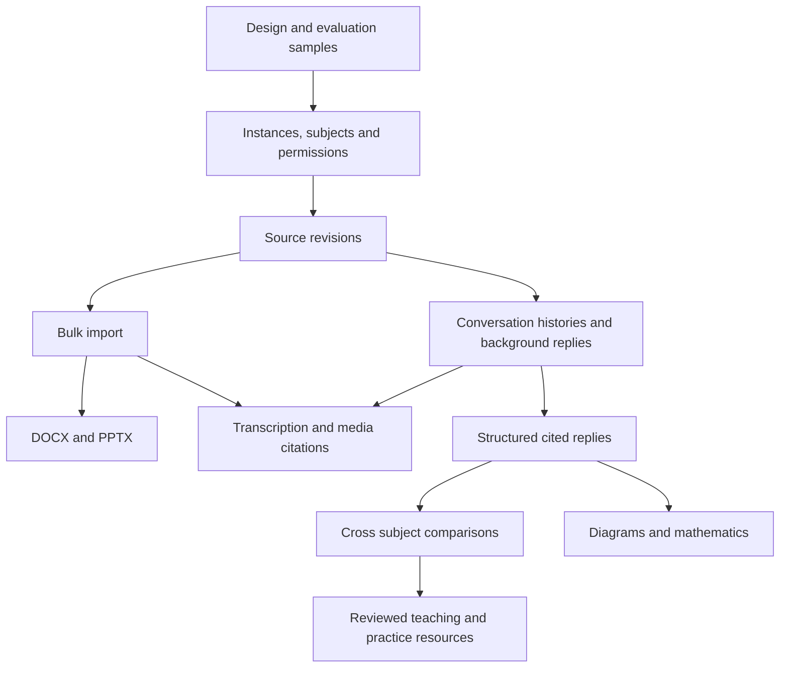

## Outcome

Deliver configurable, independent Thot installations for schools, departments, training providers
and individual learners. Within one installation, teachers can prepare materials together and
connect subjects. Learners can explore the materials they are allowed to use through separate
conversations, cited explanations and practice activities.

This task coordinates the implementation. Each linked task owns its detailed work and acceptance
criteria. Future behaviour belongs here and in those tasks until it ships. Update the living
documentation with each corresponding implementation change.

## Product boundaries

- One deployment owns its database, originals, extracted revisions, media, accounts, sessions,
  conversations, jobs, caches and backups. A department can have several subjects in that deployment.
  Separate deployments have no automatic search, identity or content sharing.
- Run the same code and migrations in every deployment. Configure the teaching context without
  maintaining school-specific branches. A separate deployment does not require a separate server.
- Offer shared and personal operation. Personal operation combines managing materials and learning
  in one account. It does not imply offline inference.
- Subject, audience level, participation and learning objective are separate choices. Applied arts
  remains an available profile. Other subjects can coexist inside the same instance.
- Preserve evidence: a citation identifies an accessible source revision and an exact location.
  Distinguish a source statement, an interpretation, a proposed activity and an unchecked result.
- Teachers decide what colleagues can use and what learners can use. Publishing a resource does
  not publish private conversations or teacher-only answer keys.
- External inference, OCR and transcription follow the instance's explicit provider policy. Siloed
  application storage does not itself promise that processing happens locally.

## Delivery order

| Increment | Usable outcome | Implementation tasks | Release evidence |
| --- | --- | --- | --- |
| A | Approved interaction blueprint and representative evaluation material | [UX-201](ux-201.md), [EVAL-103](eval-103.md) | Teacher coordination and solo-study flows have examples and failure cases |
| B | An independent instance with configurable subjects, ownership and administration | [INST-101](inst-101.md), [DOM-101](dom-101.md), [ACC-101](acc-101.md), [CFG-101](cfg-101.md) | Two isolated deployments, existing pilot migrated, general and arts profiles exercised |
| C | Teachers import and review a batch of materials with stable citations | [ING-006](ing-006.md), [ING-007](ing-007.md), [DEP-101](dep-101.md), [ING-109](ing-109.md), [ING-110](ing-110.md) | Partial batch failure, document revisions, DOCX and PPTX extraction checked |
| D | Independent conversations and useful cited comparisons between subjects | [CHAT-101](chat-101.md), [JOB-103](job-103.md), [ANS-101](ans-101.md), [RECH-102](rech-102.md) | Concurrent conversations stay separate and a comparison retrieves both subjects |
| E | Time-based sources and richer answers | [MED-101](med-101.md), [MED-102](med-102.md), [ANS-102](ans-102.md) | Timestamp citations, transcript correction, protected playback, safe diagrams and maths |
| F | Teachers prepare and publish study resources and practice activities | [PED-101](ped-101.md), reusing [FIC-101](fic-101.md), [FIC-102](fic-102.md), [REVI-101](revi-101.md) | A reviewed activity links objectives, source evidence and feedback |
| Every release | Existing installations remain usable and recoverable | [OPS-505](ops-505.md), [SRC-002](src-002.md), [EVAL-103](eval-103.md) | Migration, restore, access, quality and visual checks pass for that increment |

C and D can progress independently once their prerequisites are met. Media work depends on durable
jobs and revisions. Do not make diagram rendering a prerequisite for useful teacher comparisons.
Keep each increment deployable, with unfinished capabilities hidden rather than advertised.

## Architecture direction

Keep the existing server-rendered application, browser modules, domain boundary and SQLite
deployment. Reuse the extraction, search, verification and job mechanisms where they fit. Add
explicit records for subjects/courses, access grants, source revisions and conversations when
their owning task introduces them. Avoid a general plugin framework or a new frontend framework.

Configuration stored in the instance governs educational behaviour. Operator environment settings
continue to govern deployment paths, secrets and permitted services. Subject configuration can
specialise metadata and language, but cannot disable source access or citation verification.

Normalised source revisions connect extracted text to pages, slides, paragraphs, table cells or
time ranges. Answer blocks reference those locations through application-generated identifiers.
The model does not choose filesystem paths, executable HTML or unrestricted media URLs.

## End to end acceptance scenarios

- [ ] An art school and a music school run the same release with different profiles and independent
  data. Credentials, copied resource URLs and identifiers from one do not open the other.
- [ ] A physics teacher selects physics and art history, finds shared examples about light and
  colour, and opens the cited evidence from both subjects.
- [ ] A design history teacher compares industrialisation with a philosophy course. Source claims
  remain attributed. Proposed lesson connections are marked as proposals. Missing schedules are
  reported rather than inferred from document order.
- [ ] A REAPER learner uploads a manual, slides and a narrated demonstration, then opens a cited
  slide and video timestamp. Speech transcription does not claim to analyse the sound of music.
- [ ] A judicial training course keeps jurisdiction, applicable dates and source versions visible.
  A sociology course preserves competing authors' positions in a comparison.
- [ ] A solo learner can import, organise and study without creating a fictitious teacher or class.
- [ ] A trainer drafts an exercise from selected sources and an objective, reviews it, and publishes
  it while keeping the answer key private until the activity's feedback step.
- [ ] Two conversations run without sharing history, search scope, drafts or media playback state.
- [ ] Updating a source or correcting a transcript does not silently redirect old citations.

## Scope limits and decisions owned by tasks

Parser and transcription choices are qualification steps in ING-109, ING-110 and MED-101. They
must use representative files and the target deployment hardware before committing dependencies.
Multilingual retrieval is evaluated in DOM-101 and EVAL-103. It is not implied by removing school
labels. Rich media means playing and citing imported material, not generating audio or video.

Side-by-side conversations follow the independent-history and background-job work in CHAT-101.
Cross-instance federation, formal examination administration, automatic certification, generated
video, DAW project execution and a public course marketplace are outside this delivery.

The first implementation slice is B plus the revision prerequisites for C. It should prove that
a second subject works through configuration before adding the more expensive formats and media.
